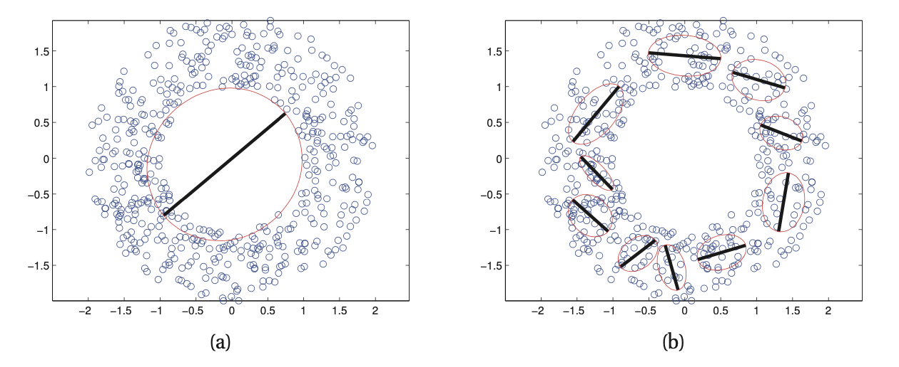

# Factor Analysis


##  Principles


- Using discrete latent variables provides limited summary (clustering)

- An alternative is to use a vector of real-valued latent 
variables, $\boldsymbol z \in \mathbb R^L$. 

-  "Factor analysis (FA)  describes variability among observed, correlated variables in terms of a potentially lower number of unobserved variables called factors." Wikipedia quote.

### PCA and FA are similar but different

PCA focuses on capturing overall variance, while FA aims to uncover underlying latent factors explaining correlations among observed variables.


## Difference between PCA and FA

| Aspect | PCA (Principal Component Analysis) | Factor Analysis (FA) |
|-------|------------------------------------|---------------------|
| Objective | Maximise total variance explained | Explain correlations using latent variables |
| Model | Pure algebraic decomposition | Statistical latent variable model |
| Equation | $Z = XW$ | $X = \Lambda F + \varepsilon$  |
| Variance used | Total variance (shared + unique + error) | Common (shared) variance only |
| Measurement error | Not modelled | Explicitly modelled via $\varepsilon$ |
| Components / Factors | Mathematical constructs | Latent causes |
| Uniqueness | Unique solution | Non-unique → requires rotation |
| Estimation | Eigen-decomposition of covariance / correlation | ML, GLS, Principal Factor, etc. |
| Main usage | Dimension reduction, compression, prediction | Construct identification, theory building |


## The model of factor analysis
We consider the observation $\boldsymbol x \in \mathbb R^D$  
$$
\boldsymbol x = \boldsymbol W \boldsymbol z + \boldsymbol \mu + \epsilon
$$
where 

  - the noise $\epsilon \sim \mathcal N_D (\boldsymbol 0, \boldsymbol \Psi)$
  - the hidden (latent) vector $\boldsymbol z \sim \mathcal N_L (\boldsymbol 0, \boldsymbol I_L)$


$$
p(\boldsymbol x | \boldsymbol z, \theta) = \mathcal N (\boldsymbol W \boldsymbol z + \boldsymbol \mu, \boldsymbol \Psi)
$$
the mean is a linear function of the (hidden) inputs

  - $\boldsymbol W$ is a $D\times L$ matrix, known as the factor loading matrix, 
  -  $\boldsymbol \Psi$ is a $D\times D$ covariance matrix that we take to be diagonal
  
The special case in which $\boldsymbol \Psi=\sigma^2 I$ is called probabilistic principal components analysis or PPCA.
  
 

## Reminder: Joint and conditional Gaussian distribution 

Let us recall that if  (see Murphy chapter 4)

  - $\boldsymbol z \sim \mathcal N(\boldsymbol \mu_z, \boldsymbol \Sigma_{zz})$ and $\boldsymbol x \sim \mathcal N(\boldsymbol \mu_x, \boldsymbol \Sigma_{xx})$ and $cov(\boldsymbol z,\boldsymbol x)=\boldsymbol \Sigma_{zx}$

then 

$$
p(\boldsymbol z, \boldsymbol x) = N (\begin{bmatrix} \boldsymbol z\\ \boldsymbol x \end{bmatrix} | \begin{bmatrix} \boldsymbol \mu_z\\ \boldsymbol \mu_x \end{bmatrix}, \begin{bmatrix} \boldsymbol \Sigma_{zz} & \boldsymbol \Sigma_{zx} \\    \boldsymbol \Sigma_{xz} & \boldsymbol \Sigma_{xx} \end{bmatrix})
$$

and

  $$
  p(\boldsymbol z, \boldsymbol x) = p(\boldsymbol z | \boldsymbol x)p(\boldsymbol x) = 
\mathcal N (\boldsymbol z |\boldsymbol \mu_{z|x}, \boldsymbol \Sigma_{z|x}) \mathcal N (\boldsymbol x| \boldsymbol \mu_x, \boldsymbol \Sigma_{xx})
  $$
where 

  - $\boldsymbol \mu_{z|x} = \boldsymbol \mu_z + \boldsymbol \Sigma_{zx} \boldsymbol \Sigma_{xx}^{-1}(\boldsymbol x-\boldsymbol \mu_x )$
  - $\boldsymbol \Sigma_{z|x} = \boldsymbol \Sigma_{zz} - \boldsymbol \Sigma_{zx}\boldsymbol \Sigma_{xx}^{-1}\boldsymbol \Sigma_{xz}$
  
  
##  Marginal and posterior distribution

### Marginal distribution 

$$
\boldsymbol x \sim \mathcal N_D (\boldsymbol \mu , \boldsymbol{\Sigma_{xx}=WW^T+ \Psi})
$$

### Posterior distribution


$$
\boldsymbol z | \boldsymbol x \sim \mathcal N_L (\boldsymbol \mu_{z|x} , \boldsymbol \Sigma_{z|x})
$$
where 

  - $\boldsymbol \Sigma_{z|x} = \boldsymbol{(I_L + W^T \Psi^{-1} W)^{-1}}=S$ 
  - $\boldsymbol \mu_{z|x} = \boldsymbol {\Sigma_{z|x}\Sigma_{xx}^{-1}} (\boldsymbol x -\boldsymbol \mu)=\boldsymbol{SW^T \Psi^{-1}}(\boldsymbol x -\boldsymbol \mu)$ 
  
### Exercice

Demonstrate the above formulas 


## Estimation 

### The mean $\boldsymbol \mu$

can be estimated by maximum likelihood 
$$
\boldsymbol \mu_{mle} =  \bar{\boldsymbol x}
$$

### $\boldsymbol W$ and $\boldsymbol \Psi$ 

are estimated using an EM algorithm


## EM algorithm 

### Data

  - Observed data $\boldsymbol:    x_{1:n}$
  - Missing (or hidden) data : $\boldsymbol:    z_{1:n}$ 
  
### Principle   

  - Starting from $\theta^0$
  - At step $q$
      - E(xpectation) step: $Q(\theta,\theta^q) = E_{Z_{1:n} | \boldsymbol x_{1:n}}[\log P( \boldsymbol x_{1:n},\boldsymbol z_{1:n},\theta)]$
      - M(aximisation) step: $\theta^{q+1} = argmax_\theta Q(\theta,\theta^q)$
      

## EM for factor analysis

Let us assume that $\boldsymbol \mu=0$ (centering of the $\boldsymbol x_i$), the complete log-likelihood is

\begin{eqnarray*}
\log{p( \boldsymbol {X,Z|\mu,W,\Psi})} &=& \sum_i \log \mathcal N_L(z_i; \boldsymbol 0,\boldsymbol I) + \log \mathcal N_D(x_i; \boldsymbol {Wz_i},\boldsymbol \Psi) \\
&=& -\frac{n}{2} \log |\boldsymbol I_L | -\frac{n}{2}  Tr(\boldsymbol{\hat{\Sigma}_{zz}}) \\
& & -\frac{n}{2} \log |\boldsymbol \Psi | -\frac{n}{2}  Tr(\boldsymbol{\hat{\Sigma}_{xx}\Psi^{-1}}) + Cst
\end{eqnarray*}
where
$$
\boldsymbol{\hat{\Sigma}_{xx}}=\frac{1}{n}\sum_i (\boldsymbol x_i - \boldsymbol{Wz_i})(\boldsymbol x_i - \boldsymbol{Wz_i})^T
$$

### Exercice 

Demonstrate the above formula

## E step

The expectation of the complete log-likelihood requires

  1. $\mathbb E_{z|x}[\boldsymbol z_i]= \boldsymbol{SW^T \Psi^{-1}}(\boldsymbol x_i -\boldsymbol \mu)$ where $\boldsymbol S = \boldsymbol{(I_L + W^T \Psi^{-1} W)^{-1}}$
  2. $\mathbb E_{z|x}[\boldsymbol{z_i z_i^T}] = E_{z|x}[\boldsymbol z_i]E_{z|x}[\boldsymbol z_i^T] + \boldsymbol S$


## M step 


Reminders

$$\frac{\partial (b^Ta)}{\partial a}=b$$
$$\frac{\partial (a^TAa)}{\partial a}=(A+A^ T)a$$
$$\frac{\partial}{\partial A}tr(BA)=B^T$$
$$\frac{\partial}{\partial A}\log |A|=(A^{-1})^T$$
$$
tr(ABC)=tr(CAB)=tra(BCA)
$$
Thus if $x$ is a vector
$$
x^T A x = tr(x^TAx)=tr(Axx^T)
$$


## M step for $\boldsymbol \Psi$

$$
\mathbb E_{z|x} \left[ \frac{\partial L({\boldsymbol W, \boldsymbol \Psi)}}{\partial{\boldsymbol \Psi^{-1}}}\right] = \mathbb E_{z|x} \left[ \frac{n}{2}(\boldsymbol  \Psi - \boldsymbol{\hat{\Sigma}_{xx}})\right] =  \frac{n}{2}(\boldsymbol  \Psi - \mathbb E_{z|x} \left[\boldsymbol{\hat{\Sigma}_{xx}}\right])=0
$$

where 
\begin{eqnarray*}
\mathbb E_{z|x} \left[\boldsymbol{\hat{\Sigma}_{xx}}\right] &= &\frac{1}{n}{\Large(} \sum_i \boldsymbol{x_i x_i^T} + W(\sum_i  \mathbb E_{z|x} \left[\boldsymbol{z_i z_i^T}\right])W^T -2W\sum_i \boldsymbol{E_{z|x} \left[z_i\right] x_i^T}{\Large)}\\
&= &\frac{1}{n}{\Large(} \sum_i \boldsymbol{x_i x_i^T} + W(\sum_i  \mathbb E_{z|x} \left[\boldsymbol{z_i x_i^T }\right])-2W\sum_i \boldsymbol{E_{z|x} \left[z_i\right] x_i^T}{\Large)}\\
&= &\frac{1}{n}{\Large(} \sum_i \boldsymbol{x_i x_i^T} -W\sum_i \boldsymbol{E_{z|x} \left[z_i\right] x_i^T}{\Large)}
\end{eqnarray*}


## M step for $\boldsymbol W$

$$
\mathbb E_{z|x} \left[ \frac{\partial L({\boldsymbol W, \boldsymbol \Psi)}}{\partial{\boldsymbol W}}\right] = \mathbb E_{z|x} \left[-\boldsymbol \Psi^{-1}\sum_i x_i z_i^T + \boldsymbol \Psi^{-1} W\sum_i z_i z_i^T \right]=0
$$


## M Step summary

### Loading matrix

$$
\boldsymbol W^{q+1} = \left(\sum_i (\boldsymbol x_i -\boldsymbol{\bar{x}}) \mathbb E_{z|x}[\boldsymbol z_i]^T\right)\left(\sum_i \mathbb E_{z|x}[\boldsymbol z_i \boldsymbol z_i^T]\right)^{-1}
$$

### Noise covariance matrix

$$
\boldsymbol \Psi^{q+1} = \frac{1}{N} diag {\huge \{ }  \sum_i \boldsymbol{x_i x_i^T} - \boldsymbol W^{q+1} \mathbb E_{z|x}[\boldsymbol z_i] \boldsymbol x_i^T {\huge\}}
$$

### Log-likelihood

The log-likelihood can be computed using the EM decomposition

$$
\log P(X;\boldsymbol \Theta) =  E_{Z_{1:n} | \boldsymbol x_{1:n}}[\log P( \boldsymbol x_{1:n},\boldsymbol z_{1:n};\theta)] - E_{Z_{1:n} | \boldsymbol x_{1:n}}[\log P( \boldsymbol z_{1:n}| \boldsymbol x_{1:n};\theta)]
$$


## Implementation of the algorithm {.allowframebreaks}

### Initialisation via a PCA
```{r initFA}
#| echo: true

initialisation.FA<-function(X,L=1){
  # Return W and Psi
  d<-ncol(X)
  Sigmaxx<-var(X)
  W<-eigen(Sigmaxx)$vectors[,1:L]
  if (L==1) W<-cbind(W)
  Psi<-rep(1,d)
  return(list(W=W,Psi=Psi))
}
```


### E step 

```{r}
#| echo: true

FA.E.step<-function(X,W,Psi){
  # X is assumed to be centered
  # M contain the contionnal expectation of the latent factor
  # S contains the covariance of the latent factor
  L<-ncol(W)
  S <- solve(diag(L) + t(W)%*%diag(1/Psi)%*%W)
  M<- X%*%diag(1/Psi)%*%W%*%S
  return(list(S=S,M=M))
}
```

### M Step
```{r}
#| echo: true

FA.M.step<-function(X,S,M,W,Psi){
  n<-nrow(X)
  Psi<-1/n*diag(t(X)%*%X -W%*%t(M)%*%X)
  W<- (t(X)%*%M)%*%solve(n*S+t(M)%*%M)
  return(list(Psi=Psi,W=W))
}
```

### Computation of the criterion
```{r}
#| echo: true

log.likelihood.FA<-function(X,S,M,Psi,W){
  n<-nrow(X)
  Sigmax<-(t(X)%*%X-W%*%t(M)%*%X)
  return(-(sum(diag(S+t(M)%*%M/n))
          +log(det(diag(Psi)))+
            log(det(S))+
            1/n*sum(diag(Sigmax%*%diag(1/Psi)))))
}
```

### Putting it all together
```{r}
#| echo: true

FA.EM<-function(X,L=1,max.iter=50){
  X<-scale(X,scale=FALSE);mu<-attr(X,"scaled:center")
  log.likelihood<-NULL; init<-initialisation.FA(X,L)
  W<-init$W;  Psi<-init$Psi; criterion<- Inf; iteration<-1;  
  log.likelihood[iteration]<--Inf
  while ((criterion>1e-6)&&(iteration<=max.iter)){
    E.step<-FA.E.step(X,W,Psi); E.step$S->S; E.step$M->M
    M.step<-FA.M.step(X,S,M,W,Psi); M.step$Psi->Psi; M.step$W->W
    iteration<-iteration+1
    log.likelihood[iteration]<-log.likelihood.FA(X,S,M,Psi,W)
    criterion<-abs((log.likelihood[iteration] - log.likelihood[iteration-1])/max(log.likelihood[iteration], log.likelihood[iteration-1]))
  }
  return(list( W=data.frame(W), Psi=Psi,
               M=data.frame(M), S=S,mu=mu,
               log.likelihood= log.likelihood[-1]))
}
```

## Example with the Iris

```{r}
data(iris); L=2
X<-scale(iris[,1:4],center=TRUE,scale=FALSE)
FA.result<-FA.EM(X,L=L,max.iter=4000)
names(FA.result$W)<-paste("Latent Factor",1:L)
names(FA.result$M)<-paste("Latent Score",1:L)
par(mfrow=c(1,3))
plot(FA.result$log.likelihood,ylab="Log-likelihood",xlab="Iteration")
plot(FA.result$M,col=iris$Species)
plot(FA.result$W)
text(FA.result$W,labels = names(iris)[1:4])
abline(h=0,v=0,col="blue")
```


## Unidentifiability

  - If we consider $\boldsymbol R$ an orthogonal rotation matrix such that

$$
\boldsymbol R \boldsymbol R^T = \boldsymbol I
$$

It appears that $\tilde{\boldsymbol  W}={\boldsymbol W \boldsymbol R}$ produces the same log-likelihood. 

  - ${\boldsymbol W}$ cannot be uniquely identified. 


## Possible rotations

1. Forcing $\boldsymbol W$ to be orthogonal with columns ordered by deacresing variance
2. Forcing $\boldsymbol W$ to be lower triangular (problem of founder variables)
3. Choosing an informative rotation matrix. For example the varimax rotation.
4. ...

| Rotation | Type        | Factors correlated? | Optimization criterion | Effect on loadings | Typical use case |
|----------|-------------|---------------------|------------------------|--------------------|------------------|
| None     | –           | –                   | None                   | Hard to interpret, mixed loadings | Never for interpretation |
| Varimax  | Orthogonal  | No                  | Maximise variance of squared loadings per factor | Each factor defined by few strong variables | General exploratory FA |
| Quartimax| Orthogonal  | No                  | Simplify variables     | One dominant general factor | When expecting one main latent trait |
| Equamax | Orthogonal  | No                  | Compromise varimax/quartimax | Mixed behaviour | Rarely used |
| Oblimin  | Oblique     | Yes                 | Minimise cross-loadings with tunable correlation | Clean structure with correlated factors | Psychology, social sciences |
| Promax   | Oblique     | Yes                 | Varimax + power transformation | Fast, realistic latent traits | Large datasets |
| Geomin   | Oblique     | Yes                 | Minimise geometric mean of loadings | Smooth, stable solution | SEM / Mplus style models |


### Varimax

Varimax rotation maximizes the sum  of the variance of the squared 
   correlations between variables and factors

$$
R_\mathrm{VARIMAX} = \operatorname{arg}\max_R \left(\frac{1}{p}\sum_{j=1}^k \sum_{i=1}^p (W R)^4_{ij} - \sum_{j=1}^k \left(\frac{1}{p}\sum_{i=1}^p (W R)^2_{ij}\right)^2\right)
$$
   
This  results in  high factor loadings for 
   a small number of variables and  low factor loadings for the rest. 
     

## Varimax
```{r}
#| echo: true

W.FA<-FA.result$W
W.Varimax<-varimax(as.matrix(FA.result$W))$loadings
print(W.Varimax)
```

     

## PCA vs FA decomposition {.allowframebreaks}

### PCA vs FA loadings comparison 

  - PCA loadings are obtained by the eigen-decomposition of the covariance or correlation matrix
  - FA loadings are obtained by the EM algorithm presented above
  - PCA loadings are orthogonal, FA loadings are not
  - PCA loadings explain total variance, FA loadings explain common variance only

###  Decompostion of PCA vs FA


PCA decomposes the covariance matrix $\boldsymbol \Sigma$ as
$$\boldsymbol \Sigma = \boldsymbol{W_{PCA} W_{PCA}^T}$$

FA decomposes the covariance matrix $\boldsymbol \Sigma$ as
$$\boldsymbol \Sigma = \boldsymbol{W_{FA} W_{FA}^T} + \boldsymbol \Psi$$
where $\boldsymbol \Psi$ is a diagonal matrix


##  Communalities and Uniqueness

**Communalities** in FA represent the proportion of each variable's variance that can be explained by the common factors. They provide insight into how well the factors capture the underlying structure of the data.

Communality for variable $j$ is defined as:
$$\text{Communality}_j = \sum_{k=1}^{L} \lambda_{jk}^2,$$
where $\lambda_{jk}$ is the loading of variable $j$ on factor $k$, and $L$ is the number of factors.


**Uniqueness** is the portion of variance that is unique to each variable and not explained by the common factors. It reflects the specific variance of each variable that is not shared with others.

Uniqueness and communalities are related as follows:  
$$\text{Communality}_j = 1 - \text{Uniqueness}_j$$


## Iris dataset FA results {.allowframebreaks}

```{r}
#| label: pca-fa-iris
#| message: false
#| warning: false

# Packages (install only if missing)
pkgs <- c("psych", "knitr")
to_install <- pkgs[!pkgs %in% rownames(installed.packages())]
if (length(to_install) > 0) install.packages(to_install, dependencies = TRUE)
library(ggplot2)
library(psych)
library(knitr)

# ----------------------------
# Data: iris (numeric columns)
# ----------------------------
X <- iris[, 1:4]
Xsc <- scale(X)                 # standardize
R <- cor(Xsc)                   # correlation matrix (PCA/FA comparable)

# ----------------------------
# PCA (2 components)
# ----------------------------
pca <- prcomp(Xsc, center = FALSE, scale. = FALSE)
pca_load <- pca$rotation[, 1:2, drop = FALSE]
pca_var  <- (pca$sdev^2) / sum(pca$sdev^2)  # proportion var explained

# ----------------------------
# FA (2 factors, ML, varimax)
# ----------------------------
fa2 <- fa(Xsc, nfactors = 2, fm = "ml", rotate = "varimax",scores = "regression") 
fa_load <- unclass(fa2$loadings)[, 1:2, drop = FALSE]
comm <- fa2$communality
uniq <- fa2$uniquenesses


#------------------------------
# Compare projections of the data
#------------------------------

# PCA scores
pca_scores <- as.data.frame(pca$x[, 1:2, drop = FALSE])
colnames(pca_scores) <- c("Dim1", "Dim2")
pca_scores$Method <- "PCA"
fa_scores <- as.data.frame(fa2$scores[, 1:2, drop = FALSE])
colnames(fa_scores) <- c("Dim1", "Dim2")
fa_scores$Method <- "FA (ML + varimax)"
scores <- rbind(pca_scores, fa_scores)
scores$Ind <- seq_len(nrow(scores))
scores$Species <- rep(iris$Species, 2)  
ggplot(scores, aes(x = Dim1, y = Dim2, color = Species)) +
  geom_text(aes(label = Ind),
            size = 3,
            nudge_x = 0.05,
            nudge_y = 0.05,
            show.legend = FALSE) +
  geom_point(size = 2, alpha = 0.8) +  facet_wrap(~ Method) +
  labs(title = "PCA vs Factor Analysis scores (iris)",
       x = "Dimension 1", y = "Dimension 2") +
  theme_minimal()

# Vizualize FA results with diagram  
fa.diagram(fa2)

# ----------------------------
# Compare in one table
# ----------------------------
tab <- data.frame(
  variable = rownames(pca_load),
  PCA1 = pca_load[,1],
  PCA2 = pca_load[,2],
  FA1 = fa_load[,1],
  FA2 = fa_load[,2],
  communality = comm,
  uniqueness = uniq
)

# pretty rounding for print
tab_print <- within(tab, {
  PCA1 <- round(PCA1, 3); PCA2 <- round(PCA2, 3)
  FA1 <- round(FA1, 3); FA2 <- round(FA2, 3)
  communality <- round(communality, 3); uniqueness <- round(uniqueness, 3)
})

kable(
  tab_print,
  caption = "Iris: PCA vs FA (ML + varimax)."
)

cat("\n\n")
cat(sprintf("*PCA variance explained:* PC1 = %.1f%%, PC2 = %.1f%% (cum. %.1f%%)\n",
            100*pca_var[1], 100*pca_var[2], 100*sum(pca_var[1:2])))
cat(sprintf("*FA variance explained (SS loadings):* F1 = %.2f, F2 = %.2f (cum. %.2f)\n",
            fa2$Vaccounted["SS loadings",1],
            fa2$Vaccounted["SS loadings",2],
            sum(fa2$Vaccounted["SS loadings",1:2])))

```


## PCA vs FA on the *iris* dataset

This table is a textbook example of when **PCA and Factor Analysis almost coincide**.

### PCA loadings

- **PC1** is dominated by *Petal.Length*, *Petal.Width*, *Sepal.Length* → a **global size axis**.  
- **PC2** is almost entirely *Sepal.Width* → a nearly pure morphological dimension.

Already, PCA provides a very clean structure.


### FA loadings (ML + varimax)

- **FA1** ≈ petal length + petal width + sepal length  
- **FA2** ≈ sepal width (with a small secondary petal effect)

The factors are **almost identical** to PC1 and PC2.


## PCA vs FA on the *iris* dataset (contd.)

### Communalities: the key diagnostic

- *Petal.Length*, *Petal.Width*, *Sepal.Length*:  
  communalities ≈ 1 → almost pure common variance → **ideal latent indicators**.
- *Sepal.Width*:  
  communality = 0.46 → more than half its variance is idiosyncratic.

This is the **only variable where FA truly disagrees with PCA**.

### Conclusion

On *iris*:

- The latent structure is extremely clean.  
- Almost all variance is shared.  
- Measurement noise is minimal.

::: {.callout-note}
When communalities are near 1, **PCA ≈ FA**.

This dataset is therefore a *good possible case for PCA* 
:::


## Relation to principal component analysis

### Assumption

If 

  - $\boldsymbol \Psi = \sigma^2 \boldsymbol I$
  - $\boldsymbol W$ is orthogonal

and 

  - $\sigma^2 \rightarrow 0$

Then 

Tipping, M. and C. Bishop (1999, Probabilistic principal component analysis. J. of Royal Stat. Soc. Series B 21(3), 611–622) showed that FA is equivalent to PCA


### Criterion 

$$
J(\boldsymbol W,\boldsymbol Z) = \| \boldsymbol X - \boldsymbol Z \boldsymbol W^T\|_F^2
$$  
where $\boldsymbol W^T \boldsymbol W=\boldsymbol I$


## A Constrained EM Algorithm for PCA (from Ahn, J.-H. and J.-H. Oh, 2003) {.allowframebreaks}

```{r}
#| echo: true

upper<-function(A){A[lower.tri(A,diag=FALSE)]<-0;return(A)}
lower<-function(A){A[upper.tri(A,diag=FALSE)]<-0;return(A)}
PCA.EM<-function(X,q=2){
  p<-ncol(X); n<-nrow(X)
  W<-diag(p)[,1:q]; M<-X%*%W # Initialisation
  Jold<-0; J<-1; iteration<-0; Error<-NULL
  while ((abs(J - Jold)>1e-3)){
    Jold<-sum((X-M%*%t(W))^2)
    S <- solve(upper(t(W)%*%W)); M<- X%*%W%*%S # E-step
    W<- (t(X)%*%M)%*%solve(lower(n*S+t(M)%*%M))# M-step
    W<-apply(W,2,function(x){x/sqrt(sum(x^2))})#orthogonalisation
    J<-sum((X-M%*%t(W))^2); Error[iteration<-iteration+1]<-J
  } 
  return(list(W=data.frame(W),M=data.frame(M),Error=Error))}
```


```{r}
library(ggplot2)
library(cowplot)
#library(ggfortify)
library(metR)
X<-scale(iris[,1:4])
W <- data.frame(prcomp(X, scale. = TRUE)$rotation)

iris.pca<-ggplot(data=W,aes(PC1,PC2,label=rownames(W)))+geom_text(col="red")+
  geom_vline(aes(xintercept=0))+
  geom_hline(aes(yintercept=0))+
  geom_segment(aes(x=0, y=0, xend=PC1, yend=PC2 ),      arrow=arrow(length=unit(0.3,"cm")),col="blue" )

pca.em.res<-PCA.EM(X)
W<-pca.em.res$W
names(W)<-paste("PC",1:2,sep="")

iris.em.pca<-ggplot(data=W,aes(PC1,PC2,label=rownames(W)))+geom_text(col="red")+
  geom_vline(aes(xintercept=0))+
  geom_hline(aes(yintercept=0))+
  geom_segment(aes(x=0, y=0, xend=PC1, yend=PC2 ),      arrow=arrow(length=unit(0.3,"cm")),col="blue" )

Error=data.frame(Error=pca.em.res$Error,Iteration=1:length(pca.em.res$Error))
iris.em.pca.error<-ggplot(data=Error,          aes(x=Iteration,y=Error))+geom_line()

plot_grid(iris.pca,iris.em.pca,
          iris.em.pca.error,
          labels = c("PCA by SVD","PCA by EM","Convergence of PCA EM"))
```


##  Mixture of factor analysers {.allowframebreaks}

  - Factor analyses is a way to estimate a variance matrix with few parameters
  - This property can be used in the context of Gaussian mixture model assuming the following parameterization for component densities:
$$
  p(\boldsymbol x_i |\boldsymbol z_i, q_i=k) = \mathcal{N}(\boldsymbol x_i | \boldsymbol \mu_k +  \boldsymbol W_k \boldsymbol z_i , \boldsymbol \Psi)
$$
  where $k$ is the  component number and $W_k$ is a loading matrix defining the relation between the observation $\boldsymbol x_i$ and the latent vector $\boldsymbol z_i$

  - This approach is simular to the Banfield-Raftery idea of decomposing the component variance matrix $k$ in volume, form et direction. 


