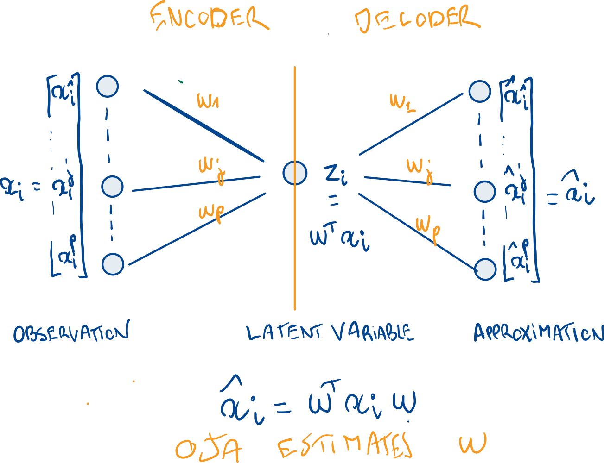

# Practical online learning

## Modeling of a neuron

The first modeling of the neuron was suggested in the 1940s by Mac Culloch and Pitts. It was a unit which according to several signals transmitted a binary response.

In general, a formal neuron has  

  - dendrites  which receive the input signal and 
  - an axon which transmits the output signal
  
### The input signal

$\boldsymbol x$ is a vector belonging most often to $\mathbb R^d$ 
or $\{0,1 \}^d$. 

### Dendrites 

are characterized by a weight vector $\boldsymbol w$ 
 
### The output 

is a function of $\boldsymbol x$ and $\boldsymbol w$, which is the composition of an input function,
$h(\boldsymbol x, \boldsymbol w)$ and an output (or activation) function, $f(h)$ 


## The neuron as a funtion 

Most of the time the input function is a simple dot product:
$$
h (\boldsymbol x, \boldsymbol w) = \boldsymbol x^T \boldsymbol w
$$

The activation functions are diverse but belong to large families (radial bases, sigmoid functions ...).


A typical activation function is for example:

$$
f (\boldsymbol x, \boldsymbol w) = \eta \cdot \frac {\exp {\{(\boldsymbol x, \boldsymbol w \}} -1} {\exp {\{(\boldsymbol x, \boldsymbol w) \}} +1}.
$$
The functions which have this appearance are said to be sigmoid 


## Neural networks


  - Neurons can be connected to each other and then form a network.
  - Learning consists of adjusting the free network parameters according to the desired goal, that is, to calculate the values of the weight vectors as a function of the inputs.
  
### Two layers networks  

  - with one input layer transmitting the input vector to the second layer neurons
  - with one output layer compressing the information of the first layer with linear activation function
  - allows to rewrite k-means and PCA with online learning (gradient descent)
  
## Hebbian Learning (1949): Biological Motivation and Derivation

### Biological Motivation

The nervous system faces a fundamental unsupervised learning problem: how can
synaptic connections self-organize from neural activity alone, with no external
teacher signal?

Donald Hebb (1949) proposed a simple answer rooted in neurophysiology, often
summarized as **"neurons that fire together, wire together"**:

> *When an axon of cell A repeatedly takes part in firing cell B, some metabolic
> change takes place such that A's efficiency as one of the cells firing B is
> increased.*

Two key biological properties follow:

- **Locality**: the update depends only on the presynaptic input $x_i$ and
  postsynaptic output $y$ — no global error signal is needed.
- **Correlation-driven plasticity**: synapses strengthen when pre- and
  postsynaptic neurons are co-active, which can explain how feature detectors
  and associative memories emerge from experience alone.

---

### Derivation via Correlation Maximisation

Consider a linear neuron with input $\boldsymbol{x} \in \mathbb{R}^d$, weight
vector $\boldsymbol{w}$, and scalar output $y = \boldsymbol{w}^T \boldsymbol{x}$.

Hebb's postulate suggests maximising the **output variance**, i.e. how much the
neuron responds to structure in the input:

$$
Q(\boldsymbol{w}) = \mathbb{E}\!\left[y^2\right]
= \boldsymbol{w}^T \boldsymbol{\Sigma}\, \boldsymbol{w},
$$

where $\boldsymbol{\Sigma} = \mathbb{E}[\boldsymbol{x}\boldsymbol{x}^T]$ (assuming
zero-mean inputs). We impose $\|\boldsymbol{w}\|^2 = 1$ to keep the problem
well-posed.

Approximating the expectation by a single sample and taking the gradient:

$$
\nabla_{\boldsymbol{w}}\, y^2
= 2y\, \boldsymbol{x},
$$

a stochastic gradient ascent step (absorbing the factor 2 into $\eta$) gives the
**pure Hebbian rule**:

$$
\boxed{\Delta \boldsymbol{w} = \eta\, y\, \boldsymbol{x}
= \eta\, (\boldsymbol{w}^T \boldsymbol{x})\, \boldsymbol{x}.}
$$

In scalar form: $w_j(n+1) = w_j(n) + \eta\, y(\boldsymbol{x})\, x_j.$

The update is **local** — exactly what Hebb's postulate requires.

---

### The Instability Problem

The pure Hebbian rule has a critical flaw: **weights grow without bound**.
Since every step increases $\|\boldsymbol{w}\|$, the neuron saturates and the
rule becomes biologically implausible (analogous to runaway synaptic
potentiation seen in pathological states such as epilepsy).

This motivates adding a **weight-decay term** to stabilise learning — which is
precisely what Oja's rule achieves, as we derive later in the chapter.


Under the constraint $\|\boldsymbol{w}\|^2=1$, the fixed point of the Hebbian
rule is the **first principal component** of $\boldsymbol{\Sigma}$ — the
connection to PCA that Oja's rule will make exact and stable.


## Stochastic Gradient Descent  {.allowframebreaks}

Statistical estimation and machine learning consider the problem of minimizing an objective function that has the form of a sum:

$$
Q(\boldsymbol w)=\frac{1}{n}\sum_{i=1}^{n}Q_{i}(\boldsymbol w),
$$
where the parameter $\boldsymbol w$ that minimizes $Q(\boldsymbol w)$ is to be estimated. 


Each summand function $Q_{i}$ is typically associated with the $i-th$ observation in the data set (used for training).

Sum-minimization problems arise:

  - in least squares and in maximum-likelihood estimation,
  - empirical risk minimization. 
  
When used to minimize the above function, a standard (or "batch") gradient descent method would perform the following iterations:

$$ 
\boldsymbol w:=\boldsymbol w-\eta \nabla Q(\boldsymbol w)=
\boldsymbol w-\frac{\eta}{n}\sum_{i=1}^{n}\nabla Q_{i}(\boldsymbol w),
$$
where $\eta$  is a step size (sometimes called the learning rate in machine learning).


## Iterative method

Fluctuations in the total objective function as gradient steps with respect to mini-batches are taken.

In stochastic (or "on-line") gradient descent, the true gradient   is approximated by a gradient at a single example:

$$
\boldsymbol w:=\boldsymbol w-\eta \nabla Q_{i}(\boldsymbol w).
$$
 
 - As the algorithm sweeps through the training set, it performs the above update for each training example.
 - Several passes can be made over the training set until the algorithm converges. 
 - If this is done, the data can be shuffled for each pass to prevent cycles. 
 - Typical implementations may use **an adaptive learning rate** so that the algorithm converges.


## Stochastic Gradient in pseudocode

 1. Choose an initial vector of parameters $\boldsymbol w$ and learning rate $\eta$
 2. Repeat until an approximate minimum is obtained:
    a. Randomly shuffle examples in the training set.
    b. For $i=1,2,\cdots,n$ do: $\boldsymbol w:=\boldsymbol w-\eta \nabla Q_{i}(\boldsymbol w).$

## Adaptative learning rate

A distinction exists between constant gain algorithms,
$$
\eta_n \geq 0, \ \ \ lim_{n \rightarrow \infty} \eta_n = \eta> 0
$$
and decreasing gain algorithms,
$$
\sum_{n = 0}^{\infty} \eta_n = \infty, \ \
  \sum_{n = 0}^{\infty} \eta_n^2 < \infty.
$$
The first are dedicated to the estimation of parameters changing slowly over time and
the second to the estimation of stable parameters.


## Convergence of Stochastic Gradient Descent (Robbins–Monro conditions)

SGD is a practical algorithm which consists of:

- Shuffle the training set at each epoch
- Update weights using one example at a time: 
- Use a decreasing learning rate 

Robbins-Monro (1951) showed that these choices guarantee convergence under reasonable assumptions.


Let consider the minimization of a differentiable objective
$$
F(w)=\mathbb{E}[f(w;\xi)],
$$
where $\xi$ is a random variable (data point / mini-batch).  
Stochastic gradient descent (SGD) is defined by
$$
w_{n+1}=w_n-\eta_n\, g_n,
\qquad
g_n:=\nabla f(w_n;\xi_n),
$$
with $(\xi_n)_n$ i.i.d., and step sizes $\eta_n>0$.

---

### Assumptions

Let $\mathcal{F}_n=\sigma(\xi_1,\dots,\xi_n)$ be the natural filtration.

1. **Unbiased gradient**
$$
\mathbb{E}[g_n\mid \mathcal{F}_n]=\nabla F(w_n).
$$

2. **$L$-smoothness of $F$**
$$
F(u)\le F(v)+\nabla F(v)^\top(u-v)+\frac{L}{2}\|u-v\|^2,
\quad \forall u,v.
$$

3. **Bounded second moment**
$$
\mathbb{E}\big[\|g_n\|^2\mid \mathcal{F}_n\big]\le G^2.
$$

4. **Robbins–Monro step sizes**
$$
\sum_{n=1}^\infty \eta_n = \infty,
\qquad
\sum_{n=1}^\infty \eta_n^2 < \infty.
$$

We also assume $F$ is bounded below:
$$
F(w)\ge F_{\inf}.
$$

---

## Theorem

Under the assumptions above,
$$
\sum_{n=1}^\infty \eta_n \|\nabla F(w_n)\|^2 < \infty
\quad \text{a.s.}
$$

In particular,
$$
\liminf_{n\to\infty}\|\nabla F(w_n)\|=0
\quad \text{a.s.}
$$

If $F$ is strongly convex, then
$$
w_n \to w^\star
\quad \text{almost surely}.
$$

---

## Proof (smooth nonconvex case)

By $L$-smoothness with $u=w_{n+1}$ and $v=w_n$,
$$
F(w_{n+1})
\le
F(w_n)
+
\nabla F(w_n)^\top (w_{n+1}-w_n)
+
\frac{L}{2}\|w_{n+1}-w_n\|^2.
$$

Since
$$
w_{n+1}-w_n=-\eta_n g_n,
$$
we obtain
$$
F(w_{n+1})
\le
F(w_n)
-
\eta_n \nabla F(w_n)^\top g_n
+
\frac{L}{2}\eta_n^2 \|g_n\|^2.
$$

Taking conditional expectation given $\mathcal{F}_n$ and using unbiasedness:
$$
\mathbb{E}\big[\nabla F(w_n)^\top g_n \mid \mathcal{F}_n\big]
=
\|\nabla F(w_n)\|^2.
$$

Using the second-moment bound:
$$
\mathbb{E}[\|g_n\|^2\mid \mathcal{F}_n]\le G^2,
$$
we get
$$
\mathbb{E}[F(w_{n+1})\mid \mathcal{F}_n]
\le
F(w_n)
-
\eta_n \|\nabla F(w_n)\|^2
+
\frac{L}{2}\eta_n^2 G^2.
$$

Rearranging:
$$
\eta_n \|\nabla F(w_n)\|^2
\le
F(w_n)
-
\mathbb{E}[F(w_{n+1})\mid \mathcal{F}_n]
+
\frac{L}{2}\eta_n^2 G^2.
$$

Taking full expectation and summing from $n=1$ to $N$:
$$
\sum_{n=1}^N
\eta_n \mathbb{E}\|\nabla F(w_n)\|^2
\le
\mathbb{E}[F(w_1)]
-
\mathbb{E}[F(w_{N+1})]
+
\frac{L}{2}G^2
\sum_{n=1}^N \eta_n^2.
$$

Since $F(w_{N+1})\ge F_{\inf}$ and
$$
\sum_{n=1}^\infty \eta_n^2 < \infty,
$$
the right-hand side is bounded uniformly in $N$.

Therefore,
$$
\sum_{n=1}^\infty
\eta_n \mathbb{E}\|\nabla F(w_n)\|^2 < \infty.
$$

A standard Robbins–Siegmund supermartingale argument then yields
$$
\sum_{n=1}^\infty
\eta_n \|\nabla F(w_n)\|^2 < \infty
\quad \text{a.s.}
$$

Finally, since
$$
\sum_{n=1}^\infty \eta_n = \infty,
$$
if $\|\nabla F(w_n)\|$ stayed bounded away from zero,
the series above would diverge — contradiction.

Hence
$$
\liminf_{n\to\infty}\|\nabla F(w_n)\|=0.
$$

---

### Interpretation

- $\sum \eta_n = \infty$ ensures infinite effective descent time.
- $\sum \eta_n^2 < \infty$ ensures the stochastic noise has finite cumulative variance.

A classical admissible choice is
$$
\eta_n = \frac{c}{n}.
$$


## K-means and Winner take all {.allowframebreaks}


is a computational principle applied in computational models of neural networks by which neurons in a layer compete with each other for activation. 

The simplest form of competitive learning modifies only the weight vector of "the  best"  neuron at every stage of learning. 


In fact, with each presentation of a
input (a vector of the training set), two steps are performed:

  1. choose the best neuron, i.e. the one that shows the most
  important output
  2.  modify the weight vector of this neuron.
  

When the activation function is increasing (which is not true for the functions with
radial basis), the winning neuron is the one that produces the greatest value of function entry.

If we consider a dot product as an input function, the weight vector of the winner, $i^*$, checks:
$$
\forall i, \ (\boldsymbol w_ {i^*} \cdot \boldsymbol x) \geq (\boldsymbol w_{i} \cdot \boldsymbol x).
$$
And if  *the weight vectors are normalized*, the winner is the neuron that has the weight vector, closest to the input $\boldsymbol x$, in the sense of the Euclidean distance.

The coordinates of the winner's weight vector are updated using a rule of the type
following :

$$
\boldsymbol w_{i*}(t + 1) = \boldsymbol w_{i^*} (t) + \eta (t) \cdot (\boldsymbol x - \boldsymbol w_{i^*} (t)), \ \eta (t) \leq 1
$$
where $\eta(t)$ is the training step at iteration $t$.


## Stochastic Gradient for Kmeans (online Kmeans)

The criterion to be optimized can be written as

$$
Q(\boldsymbol w_1, \cdots, \boldsymbol w_K) = \frac{1}{2n} \mathbb  \sum_i \sum_k I_{(k = \arg min_\ell \|\boldsymbol x_i - \boldsymbol w_\ell \|^2  )} \|\boldsymbol x_i - \boldsymbol w_k\|^2 
$$


 1. Choose an initial vector of parameters $\boldsymbol w$ and learning rate $\eta$
 2. Repeat until an approximate minimum is obtained:
    a. Randomly shuffle examples in the training set.
    b. For $i=1,2,\cdots,n$ do:
        1. For $k=1,2,\cdots,K$
          - $\nabla Q_{i}(\boldsymbol w_k)  = -\frac{1}{n}  I_{(k = \arg min_\ell \|\boldsymbol x_i - \boldsymbol w_\ell \|^2  )} (\boldsymbol x_i - \boldsymbol w_k)$
          - $\boldsymbol w_k:=\boldsymbol w_k-\eta \nabla Q_{i}(\boldsymbol w_k).$


## Kmeans implementation

```{r}
#| echo: true

kmeans.winner.take.all<-function(X,K=2,max.iteration=2000){
  p<-ncol(X);  n<-nrow(X);shuffling<-sample(1:n,n)
  X<-X[shuffling,];  W<-X[sample(1:n,K),]
  Q<-rep(0,max.iteration); cluster<-rep(0,n)
  distances<-rep(sum(diag(var(X)))*(n-1)/n,n)
  for (i in 1:max.iteration){
    x<-cbind(X[(i-1)%%n + 1,])
    distances.x.to.W<-sum(x^2)-2*as.matrix(x)%*%t(W)+ colSums(t(W^2))
    winner.index<-which.min(distances.x.to.W)
    W[winner.index,]<-W[winner.index,] + 1/i*(x-W[winner.index,])
    cluster[(i-1)%%n + 1]<-winner.index
    distances[(i-1)%%n + 1]<-distances.x.to.W[winner.index]
    Q[i]<-mean(distances) }
  return(list(W=W,Q=Q,cluster=cluster[order(shuffling)]))
}
```

## One line kmeans example with Fisher iris

```{r}
#| echo: true
data(iris)
X<-iris[,1:4]
set.seed(1)
kmeans.winner.take.all(X,3)->res
table(res$cluster,iris$Species)
```

## One line kmeans example with Fisher iris

```{r}
#| echo: false
#| 
library(ggplot2)
ggplot(data=data.frame(Error=res$Q,Iteration=1:length(res$Q)),
                       aes(x=Iteration,y=Error))+geom_line()+
geom_hline(aes(yintercept=kmeans(X,3,iter.max =20,nstart = 10 )$tot.withinss/nrow(X),col="red"))
```

## PCA and Oja's rule 

Consider a  linear  neuron with output $z=\boldsymbol w^T \boldsymbol x$ that returns a linear combination of its inputs 
$\boldsymbol x$ using presynaptic weights $\boldsymbol w$.





Oja's rule defines the change in presynaptic weights $\boldsymbol w$ given the output response $y$ of a neuron to its inputs $\boldsymbol x$ to be

$$
\boldsymbol w:=\boldsymbol w-\eta z(\boldsymbol x - z\boldsymbol w)
$$


## Stochastic Gradient PCA and Oja's rule 

The criterion to be optimized can be written as

$$
Q(\boldsymbol w) = \frac{1}{2n}   \sum_i  \|\boldsymbol x_i -  \hat{\boldsymbol x_i}\|^2 = \frac{1}{2n} \sum_i  \|\boldsymbol x_i -  y_i \boldsymbol w \|^2=\frac{1}{2n} \sum_i  \|\boldsymbol x_i -  \boldsymbol w^T \boldsymbol x_i \boldsymbol w\|^2  
$$
where $\| \boldsymbol w\|^2=1$.


 1. Choose an initial vector of parameters $\boldsymbol w$ and learning rate $\eta$
 2. Repeat until an approximate minimum is obtained:
    a. Randomly shuffle examples in the training set.
    b. For $i=1,2,\cdots,n$ do:
          - $\nabla Q_{i}(\boldsymbol w) = y_i (\boldsymbol x_i - y_i \boldsymbol w)$
          - $\boldsymbol w:=\boldsymbol w-\eta \nabla Q_{i}(\boldsymbol w).$


## Oja's rule implementation

```{r}
#| echo: true
Oja.rule<-function(X,max.iteration=10000,eta=0.001){
  p<-ncol(X);  n<-nrow(X)
  w<-rbind(rep(1,p)); w<-w/(sqrt(sum(w^2)))
  Q<-rep(0,max.iteration)
  for (i in 1:max.iteration){
    Q[i]<- 1/(2*n) *sum((X - X%*%t(w)%*%w)^2)
    x<-X[(i-1)%%n + 1,]
    y<-sum(w*x)
    w<-w + eta*y*(x-w*y)}
  return(list(w=w,Q=Q))
}
```

## Oja's rule example with Fisher iris


```{r}
data(iris)
X<-scale(iris[,1:4],center=TRUE,scale=FALSE)
n<-nrow(X)
X<-as.matrix(X[sample(1:n),])
pca.oja<-Oja.rule(X)
w.oja<-pca.oja$w
Q<-pca.oja$Q
w.pca<-rbind(eigen(cov(X))$vector[,1])
Error.pca<- 1/(2*n) *sum((X - X%*%t(w.pca)%*%w.pca)^2)
library(ggplot2)
ggplot(data=data.frame(Error=Q,Iteration=1:length(Q)),
                       aes(x=Iteration,y=Error))+geom_line()+
                       geom_hline(aes(yintercept=Error.pca,col="red"))
```

