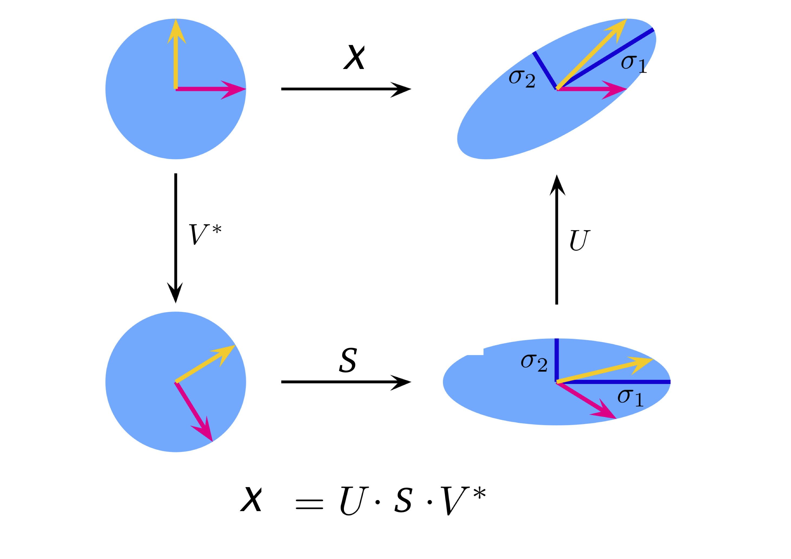
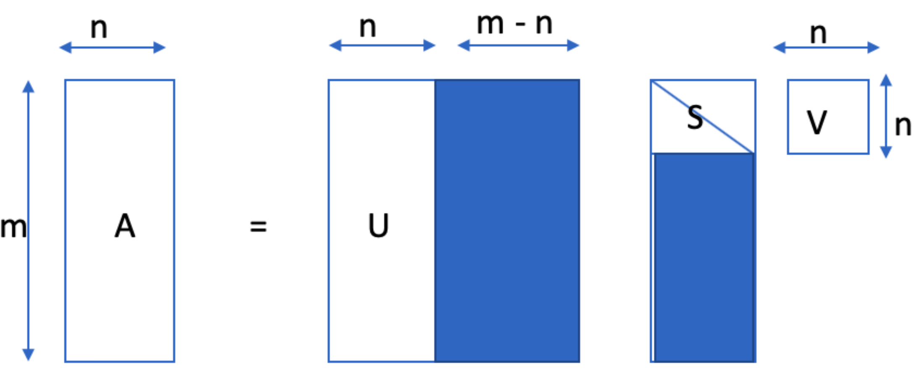
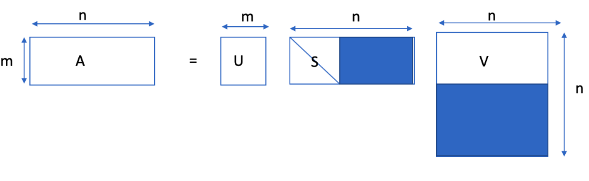

# Singular Value Decomposition


Singular Value Decomposition (SVD) is a powerful matrix factorization technique that decomposes a matrix into three matrices: $\boldsymbol U$, $\boldsymbol S$, and $\boldsymbol V^T$. It has numerous applications in machine learning, including dimensionality reduction, latent semantic analysis, principal component analysis, recommender systems, image compression, and matrix completion.


## Single value decomposition (SVD)

### Eigendecomposition of symmetric matrices

$\forall \boldsymbol A \in \mathbb R^{n\times n}$, there exist an
orthonormal matrix $\boldsymbol Q \in R^{n\times n}$ and a diagonal
matrix $\boldsymbol \Lambda = diag(\lambda_1, \cdots, \lambda_n)$

$$
A=\boldsymbol Q \boldsymbol\Lambda \boldsymbol Q^T
$$

### Singular Value Decomposition

Extend the decomposition to **rectangular matrices**

$$
\boldsymbol X = \boldsymbol{USV^T}
$$

## Applications in machine learning

- **Dimensionality Reduction**: SVD can be used for dimensionality reduction by reducing the rank of a matrix

- **Latent Semantic Analysis**: By decomposing a term-document matrix using SVD, LSA can capture the latent semantic structure of the data 

- **Principal Component Analysis (PCA)**: PCA is a SVD 

- **Recommender Systems**: By factorizing the matrix using SVD, we can identify latent factors or features that capture underlying patterns and preferences. 

- **Image Compression**: SVD is used in image compression techniques such as JPEG. 

- **Matrix Completion**: SVD-based techniques are used in matrix completion problems, where missing or incomplete data needs to be imputed.
- ...

## Existence of the SVD for general matrices

For any matrix $\boldsymbol X \in \mathbb R^{n\times d}$, there exist
two orthogonal matrices $\boldsymbol U \in \mathbb R^{n\times n}$,
$\boldsymbol V \in \mathbb R^{d\times d}$ and a nonnegative,
''diagonal'' matrix $\boldsymbol S \in \mathbb R^{n\times d}$ such that

$$
\boldsymbol X_{n\times d} =\boldsymbol U_{n\times n} \boldsymbol S_{n\times d}\boldsymbol V_{d\times d}^T
$$

where $\boldsymbol U^T \boldsymbol U=\boldsymbol I$ and
$\boldsymbol V^T \boldsymbol V=\boldsymbol I$.

### In a vector form

$$
\boldsymbol X_{n\times d} = \sum_{j=1}^r S_{jj}     \boldsymbol u_j \boldsymbol v_j^T
$$ where $r=rank(\boldsymbol X)$.

## Geometrical interpretation

Given any matrix $\boldsymbol X \in \mathbb R^{n\times d}$ it defines a linear
transformation:

$$
f : \mathbb R^d \rightarrow \mathbb R^n, f(\boldsymbol x) = \boldsymbol X \boldsymbol x.
$$ The linear transformation $f$ can be decomposed into three
operations:

$$
\underbrace{\boldsymbol X}_{linear \ transformation} \boldsymbol x =
 \underbrace{\boldsymbol U}_{rotation}  \underbrace{ \boldsymbol S}_{scaling}  \underbrace{\boldsymbol V^T}_{rotation} {\boldsymbol x}
$$

## Geometrical interpretation



## Different versions of SVD

-   Full SVD: 

$$
    X_{n\times d} =\boldsymbol U_{n\times n} \boldsymbol S_{n\times d}\boldsymbol V_{d\times d}^T
$$
-   Economy sized (thin, compact) SVD:

$$
    X_{n\times d} =\boldsymbol U_{n\times r} \boldsymbol S_{r\times r}\boldsymbol V_{r\times d}^T
$$

## SVD $n>d$



## SVD $n<d$



## Existence of the SVD {.allowframebreaks}

Consider
$\boldsymbol A=\boldsymbol X^T \boldsymbol X = \boldsymbol V \boldsymbol\Lambda \boldsymbol V^T$
where $\boldsymbol \Lambda =diag(\lambda_1,\cdots , \lambda_d)$ with
$\lambda_1 \geq \cdots \geq \lambda_r > 0 = \lambda_{r+1} =\cdots= \lambda_d$
(where $r = rank(\boldsymbol X) \leq d$).

Let $\sigma_i=\sqrt{\lambda_i}$ and correspondingly form the matrix 

$$
\boldsymbol S_{n\times d} = 
\begin{pmatrix}
diag(\sigma_1,\cdots,\sigma_r) & 0_{r\times (d-r)}\\
0_{(n-r)\times r} &  0_{(n-r)\times(d-r)}
\end{pmatrix}
$$

Define also 

$$
\boldsymbol u_i =\frac{1}{\sigma_i}
\boldsymbol X \boldsymbol v_i \in \mathbb R^n,
$$ for each $1 \leq i \leq r$.

## Existence of the SVD 

### Exercice

It is easy to show that the $\boldsymbol u_1,\cdots,\boldsymbol u_r$ are orthonormal vectors.

::: {.notes}
$$
\boldsymbol u_i^t \boldsymbol u_j = \frac{1}{\sigma_i \sigma_j} \boldsymbol v_i^T \boldsymbol X^T \boldsymbol X \boldsymbol v_j = \frac{1}{\sigma_i \sigma_j} \boldsymbol v_i^T \boldsymbol V \boldsymbol \Lambda \boldsymbol V^T \boldsymbol v_j = \frac{\lambda_i}{\sigma_i \sigma_j} \boldsymbol  = 0 \quad \text{if } i\neq j
$$
:::


### Completion if needed {.allowframebreaks}

Choose $\boldsymbol u_{r+1},\cdots,\boldsymbol u_n\in \mathbb R^n$
(through basis completion) such that

$$
\boldsymbol U = [\boldsymbol u_1 \cdots \boldsymbol u_n] \in  \mathbb R^{n\times n}
$$ is an orthogonal matrix.

It verifies

$$
\boldsymbol X \boldsymbol V = \boldsymbol U \boldsymbol S,
$$ i.e.,

## Existence of the SVD {.allowframebreaks}

$$
\small
\boldsymbol X [\boldsymbol v_1, \cdots \boldsymbol v_r \boldsymbol v_{r+1} \cdots \boldsymbol v_d] = [\boldsymbol u_1 \cdots \boldsymbol u_r \boldsymbol u_{r+1} \boldsymbol u_n]
\begin{pmatrix}
diag(\sigma_1,\cdots,\sigma_r) & 0_{r\times (d-r)}\\
0_{(n-r)\times r} &  0_{(n-r)\times(d-r)}
\end{pmatrix}
$$

Two possible cases:

-   $1 \leq i \leq r: \boldsymbol X \boldsymbol v_i = \sigma_i \boldsymbol u_i$
    by construction.
-   $i > r: \boldsymbol X\boldsymbol v_i = 0$, which is due to
    $\boldsymbol X^T \boldsymbol X \boldsymbol v_i = \boldsymbol C\boldsymbol v_i = 0 \boldsymbol v_i = 0$.

Consequently, we have obtained that 

$$
\boldsymbol X = \boldsymbol U\boldsymbol S\boldsymbol V^T
$$

## Properties
The linear application characterized by $\boldsymbol X$ has the following properties:

-   $rank(\boldsymbol X)=r$ is the number of non zero singular values
-   $kernel(\boldsymbol X)= span({\boldsymbol v_{r+1}, \cdots , \boldsymbol v_n})$
-   $range(\boldsymbol X) = span({\boldsymbol u_1,\cdots, \boldsymbol u_r })$

## Low rank approximation of a matrix $X$

### Goal

Approximate a given matrix $\boldsymbol X$ with a rank-k matrix, for a target rank
k.

### Motivations

-   Compression
-   De-noising
-   Matrix completion


## A first toy example {.allowframebreaks}

```{r}
#| echo: true
X<-matrix(c(1, 2, 3, 4, 5, 6, 7, 8, 9, 10, 11, 12),4,3,byrow=TRUE)
X.svd<-svd(X)
cat("Original matrix:\n")
print(X)
k<-2
cat("Approximation of rank 2:\n")
print(X.svd$u[,1:k]%*%diag(X.svd$d[1:k])%*%t(X.svd$v[,1:k]))
cat("A basis of the column space:\n")
print(X.svd$u[,1:k])
cat("\nA basis of the kernel:\n")
print(X.svd$u[,1:k])
```


## Illustration of svd in image compression  {.allowframebreaks}

See the demo of  [Tim Baumann](https://timbaumann.info/svd-image-compression-demo/)

Example borrowed from [rich-d-wilkinson.github.io](https://rich-d-wilkinson.github.io/MATH3030/3-5-lowrank.html#eq:svdreduced)

The 512 × 512 colour image is stored as three matrices R, B, G of the same dimension  512×512  giving the intensity of red, green, and blue for each pixel. Naively storing this matrix requires 5.7Mb.


```{r}
#| echo: TRUE
library(tiff)
library(rasterImage)
peppers<-readTIFF("../data/Peppers.tiff")
plot(as.raster(peppers))
```
## Illustration of svd in image compression  {.allowframebreaks}

Below the SVD of the three colour intensity matrices, and the view the image that results from using reduced rank versions with rank $k\in \{5,30,100,300\}$


```{r}
#| echo: TRUE
#| out.width: "100%"
#| out.height: "100%"

svd_image <- function(im,k){
  s <- svd(im)
  Sigma_k <- diag(s$d[1:k])
  U_k <- s$u[,1:k]
  V_k <- s$v[,1:k]
  im_k <- U_k %*% Sigma_k %*% t(V_k)
   ## the reduced rank SVD produces some intensities <0 and >1. 
  # Let's truncate these
  im_k[im_k>1]=1
  im_k[im_k<0]=0
  return(im_k)
}

par(mfrow=c(2,2), mar=c(1,1,1,1))

pepprssvd<- peppers
for(k in c(4,30,100,300)){
  svds<-list()
  for(ii in 1:3) {
    pepprssvd[,,ii]<-svd_image(peppers[,,ii],k)
  }
  plot(as.raster(pepprssvd))
}
```


## Low rank approximation of a matrix $\boldsymbol X$

### Frobenius norm

The Frobenius norm of a matrix $\boldsymbol X$ is defined as 

$$
\| \boldsymbol X\|^2_F  = \sum_{ij} X_{ij}^2 = trace(\boldsymbol X^T \boldsymbol X) = \sum_{j=1}^r \sigma_j^2
$$

### Rank k matrix $\hat{\boldsymbol X}_k$

Let 

$$
\hat{\boldsymbol X}_k = \sum_{j=1}^k \sigma_j \boldsymbol u_j \boldsymbol v_j^T
$$

## Low rank approximation of a matrix

For any matrix $\boldsymbol X \in \mathbb R^{n\times d}$ with non null
singular values $\sigma_1 \geq \sigma_2 \geq\ \cdots \geq \sigma_r$

$$
\hat{\boldsymbol X}_k=\arg\min_{\hat{X} :rank(\hat{X})=k} \|  {\boldsymbol X}- \hat{\boldsymbol X} \|^2_F
$$

$$
\min_{\hat{X} :rank(\hat{X})=k} \|  {\boldsymbol X}- \hat{\boldsymbol X} \|^2_F = \sum_{j=k+1}^n \sigma_j^2
$$

## Proof

We have

$$\|X-X_{k}\|_{F}^{2}=\left\|\sum _{i=k+1}^{n}\sigma _{i} u_{i}v_{i}^{\top }\right\|_{F}^{2}=\sum _{i=k+1}^{n}\sigma _{i}^{2}
$$
We need to show that if $Y_{k}=AB^{\top }$ where $A$ and $B$ have k
columns then 

$$
\|X-X_{k}\|_{F}^{2}=\sum _{i=k+1}^{n}\sigma _{i}^{2}\leq \|X-Y_{k}\|_{F}^{2}.
$$

## Proof {.allowframebreaks}

By the triangle inequality with the spectral norm, if $X=X'+X''$ then
$\sigma _{1}(X) \leq \sigma_{1}(X')+\sigma _{1}(X'')$ .

Suppose $X'_{k}$ and $X''_{k}$ respectively denote the rank k
approximation to $X'$ and $X''$ by SVD.

Then, for any $i,j \geq 1$

$$
\begin{aligned}\sigma _{i}(X')+\sigma _{j}(X'')&=\sigma _{1}(X'-X'_{i-1})+\sigma _{1}(X''-X''_{j-1})\\
&\geq \sigma _{1}(X-X'_{i-1}-X''_{j-1})\\
&\geq \sigma _{1}(X-X_{i+j-2})\qquad ({\text{since }}{\text{rank}}(X'_{i-1}+X''_{j-1})\leq {\text {rank\,}}(X_{i+j-2}))\\&=\sigma _{i+j-1}(X).
\end{aligned}
$$

:::{.notes}


- Notice that the ith biggest singular value of $X$, $\sigma _{i}(X)$, is the first singular value of $\sigma _{1}(X-X_{i-1})$
- ${\text{rank}}(X'_{i-1}+X''_{j-1})\leq {\text{rank\,}}(X_{i+j-2})$ because the columns of each matrix are at most independant and the ${\text{rank}}(X'_{i-1}+X''_{j-1}) = i+j-2$

:::


## Proof

Since $\sigma _{k+1}(Y_{k})=0$, when $X'=X-Y_{k}$ and $X''=Y_{k}$ we
conclude that for $i\geq 1,j=k+1$

$\sigma _{i}(X-Y_{k})+\underbrace{\sigma _{k+1}(Y_{k})}_{0} \geq \sigma _{k+i}(X).$ Therefore,

$$
\|X-Y_{k}\|_{F}^{2}=\sum _{i=1}^{n}\sigma _{i}(X-Y_{k})^{2}\geq \sum _{i=k+1}^{n}\sigma _{i}(X)^{2}=\|X-X_{k}\|_{F}^{2}.
$$

## Low rank approximation of a matrix and projection {.allowframebreaks}

If $rank(\hat{X})=k$, then we can assume columns $\hat{X}_i$ of
$\hat{\boldsymbol X} \in E_k=span\{\boldsymbol w_1, \boldsymbol w_2,\cdots , \boldsymbol w_k\}$
where $\{\boldsymbol w_1, \boldsymbol w_2,\cdots , \boldsymbol w_k\}$ is
a set of orthonormal vectors for the linear space of columns of $X_k$.
First, observe that

$$
\| \boldsymbol X-\hat{\boldsymbol X} \|^2_F = \sum_i \|X_i - \hat{X}_i\|^2
$$

### Optimum solution is the orthogonal projection

For each term $\| X_i-v \|_2^2$,the optimum solution is the projection
of $X_i$ onto
$E_k=span \{\boldsymbol w_1, \boldsymbol w_2,\cdots , \boldsymbol w_k \}$:

$$
\hat{X}_i = \sum_{j=1}^k \langle X_i,\boldsymbol w_j \rangle \boldsymbol w_j = \Pi_{E_k} X_i.
$$

where $\Pi_{E_k}=\sum_{j=1}^k \boldsymbol w_j\boldsymbol w_j^T$

## Projection on the orthogonal subspace {.allowframebreaks}

Consider $\Pi_{E^\perp_k}$ the projection matrix on the space orthogonal
to $E_k$. More precisely, let us add
$\boldsymbol w_{k+1},\cdots,\boldsymbol w_n$ such that
$\boldsymbol w_{1},\cdots,\boldsymbol w_n$ form an orthonormal basis of
$\mathbb R^n$. Then,

$$
\Pi_{E^\perp_k}=\sum_{j=k+1}^n \boldsymbol w_j\boldsymbol w_j^T
$$

$$
\| X-\hat X \|^2_F = \| X-\Pi_{E_k}  X \|^2_F = \| (I-\Pi_{E_k})  X \|^2_F = \|\Pi_{E^\perp_k}  X \|^2_F
$$


## Relation to principal component analysis {.allowframebreaks}

### Warning

**$\boldsymbol X$ is considered as centered**. This  tranformation (cloud translation allows considerable simplification)

### Decomposition of $X$ 

Considering the orthonal projection on $E_k$ $$
\boldsymbol X= \Pi_{E_k} \boldsymbol X + \Pi_{E^\perp_k}  \boldsymbol X
$$


## Criterion

$$
\| \boldsymbol X\|^2_F= \underbrace{\|\Pi_{E_k} \boldsymbol X\|^2_F}_{approximation} + \underbrace{\|\Pi_{E^\perp_k}  \boldsymbol X\|^2_F}_{error}
$$


In terms of intertia, PCA maximizes the projected inertia (approximation) while minimizing the ditances to the space of projection (error): 
$$
I_T =  I_E+ I_{E^\perp_k}
$$

## Best low rank approximation

$$
\hat{\boldsymbol X}_k=\Pi_{E_k} \boldsymbol X = \sum_{j=1}^k \sigma_j \boldsymbol u_j \boldsymbol v_j^T = \boldsymbol  U_{\bullet,1:k} \boldsymbol  S_{1:k,1:k} \boldsymbol  V_{\bullet,1:k}^T
$$ where
$\boldsymbol X=\underbrace{\boldsymbol U}_{n\times n}\ \underbrace{\boldsymbol S}_{n\times d}\underbrace{\boldsymbol V}_{d\times d}^T$


## Different views of the approximation

The approximation $$
\|  \boldsymbol X - \hat{\boldsymbol X} \|^2_F
$$ can be considered in multiple ways:

-   approximation of the row
-   approximation of the columns

### Notations

If $\boldsymbol X$ is a data table,

-   each row $\boldsymbol x_i^T$ is a description of an individual
-   each colum $X_j$ is variable describing $n$ individuals

## Rows approximation (projection of the individuals)

Transposing the matrix the best low rank approximation becomes

$$
\hat{\boldsymbol X^T}_k=\Pi_{F_k} \boldsymbol X^T = \sum_{j=1}^k \sigma_j \boldsymbol v_j \boldsymbol u_j^T = \boldsymbol  V_{\bullet,1:k} \boldsymbol  S_{1:k,1:k} \boldsymbol  U_{\bullet,1:k}^T
$$ where $F_k=span\{\boldsymbol v_1,\cdots, \boldsymbol v_k\}$


## The approximation error 


$$
\begin{aligned}
\|\boldsymbol X - \hat{\boldsymbol X}\|^2_F  = \|\boldsymbol X^T - \hat{\boldsymbol X^T}\|^2_F & =& \sum_i \|\boldsymbol x_i - \hat{\boldsymbol x}_i\|^2_2
\end{aligned}
$$ Each row $\boldsymbol x_i$ is approximated by

$$
\hat{\boldsymbol x_i} = \Pi_{F_k} \boldsymbol x_i = V_{F_k} V_{F_k}^T \boldsymbol x_i
$$ where $\boldsymbol V_{F_k}$ is the matrix composed of the vectors
defining $F_k$.


## Projection of the variables

$\Pi_{E_k}$ is the projection matrix on
$E=span(\boldsymbol u_1, \cdots, \boldsymbol u_k)$

$$
\Pi_E = \boldsymbol U_{E_k} \boldsymbol U_{E_k}^T
$$ and $$
\Pi_{E_k} \boldsymbol X = 
\boldsymbol U_{1:n,1:k}  \underbrace{\boldsymbol U_{1:n,1:k}^T \boldsymbol  U_{1:n,1:n}}_{(I_k, 0_{k,n-k})} \boldsymbol S_{1:n,1:k}\boldsymbol  V_{1:d,1:d}^T = \boldsymbol  U_{1:n,1:k} \boldsymbol  S_{1:k,1:k} \boldsymbol  V_{1:d,1:k}^T
$$

## k first principal components

$$
\boldsymbol C_{1:n,1:k} = \boldsymbol U_{E_k} \boldsymbol S_{1:k,1:k}
$$ where $\boldsymbol S_{1:k,1:k} = diag(\sigma_1,\cdots, \sigma_k)$.

The principal component are the coordinates of the projection of the
rows of $\boldsymbol X$ on $F_k$:

$$
\boldsymbol C_{1:n,1:k} = \boldsymbol X \boldsymbol V_{1:d,1:k}
$$

## Percentage of information

We have
$\boldsymbol C_{\bullet,1:k}^T \boldsymbol C_{\bullet,1:k} = S_{1:k,1:k}^2 = diag(\sigma_1^2,\cdots,\sigma_k^2)$,
thus $$
\|\boldsymbol C_{\bullet,1:k}\|^2_F = \sum_{j=1}^k \sigma_j^2
$$

and

$$
\frac{\| \boldsymbol C_{\bullet,1:k} \|^2_F}{\| \boldsymbol X \|^2_F}=\frac{\sum_{j=1}^k \sigma_j^2}{\sum_{j=1}^d \sigma_j^2}\in [0,1]
$$

## Correlations

$$
\widehat{cor}(\boldsymbol X_{\bullet,j},\boldsymbol C_{\bullet,k}) = \frac{X_{\bullet,j}^T\boldsymbol C_{\bullet,k}}{\|X_{\bullet,j}\| \|\boldsymbol C_{\bullet,k}\|}= \cos\widehat{(\boldsymbol X_{\bullet,j},\boldsymbol C_{\bullet,k})}
$$

## Duality

It is easy to show that

-   the columns of $\boldsymbol V$ are the eigenvector of
    $\boldsymbol X^T \boldsymbol X$
-   the columns of $\boldsymbol U$ are the eigenvector of
    $\boldsymbol X \boldsymbol X^T$

Thus the principal component of $\boldsymbol X^T \boldsymbol X$ are the
eigenvectors of $\boldsymbol X \boldsymbol X^T$ and vice-versa
