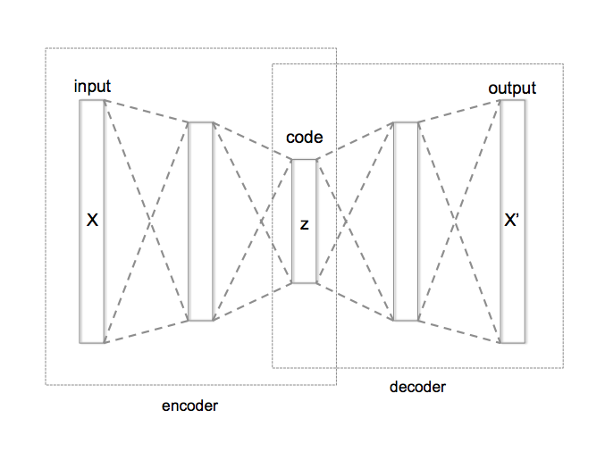
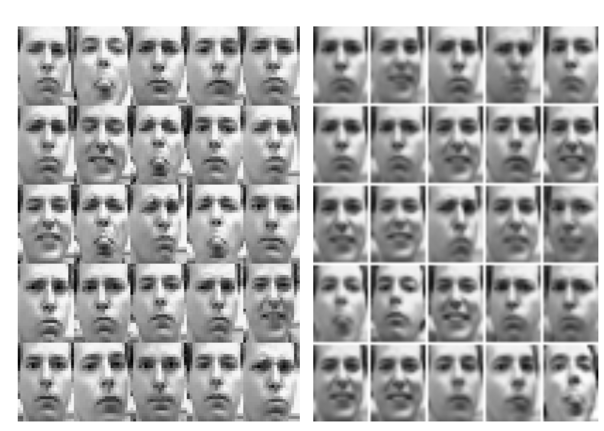
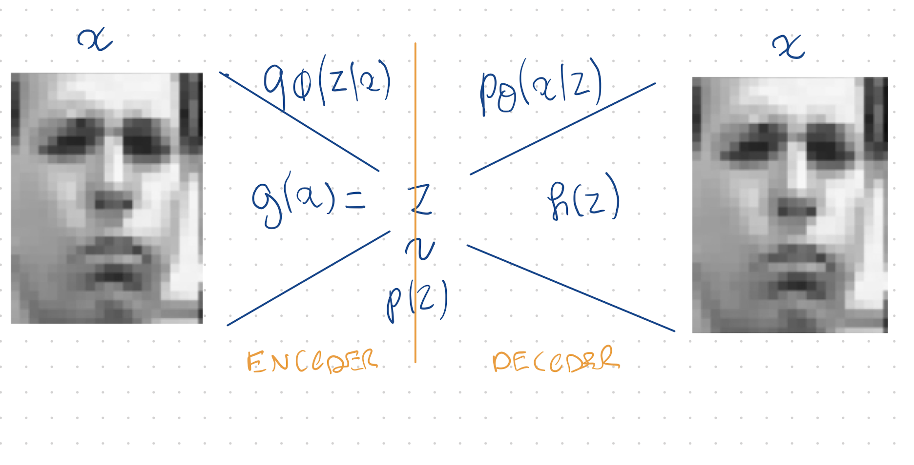
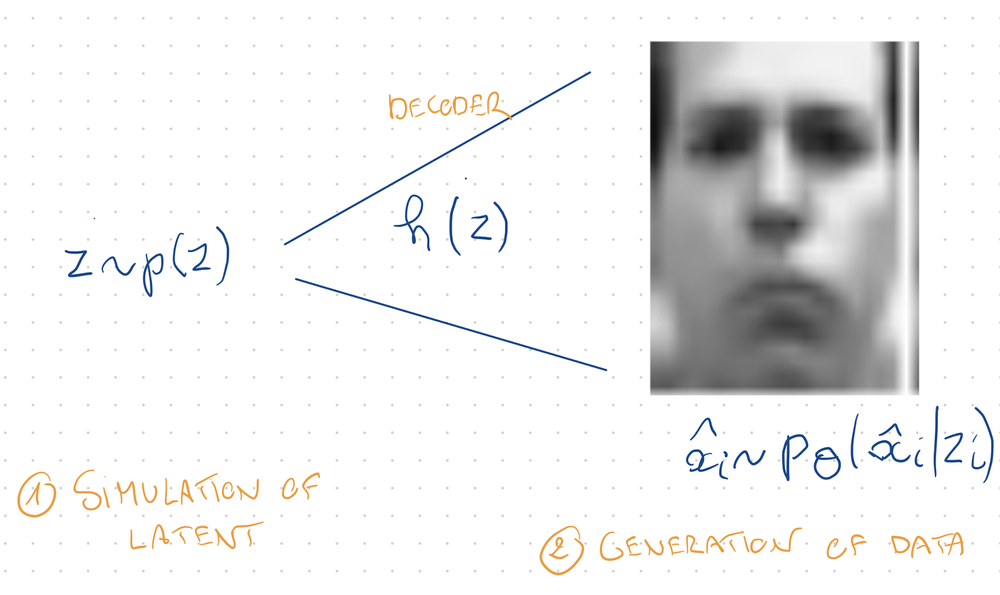
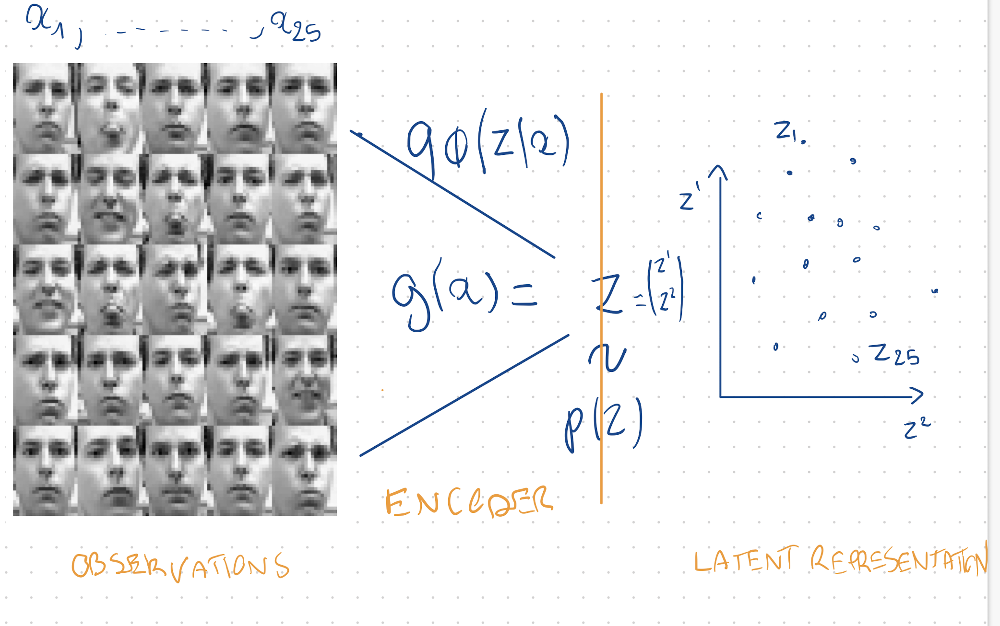
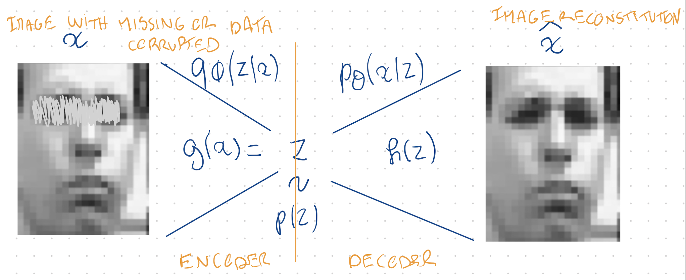
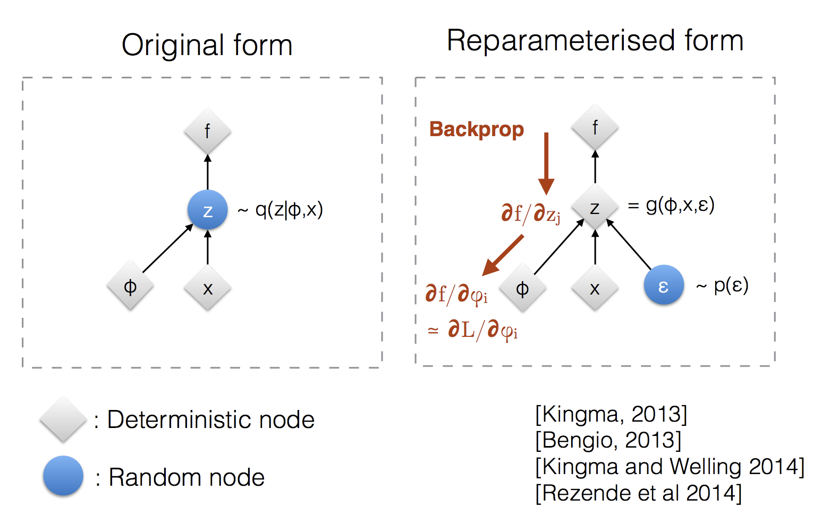
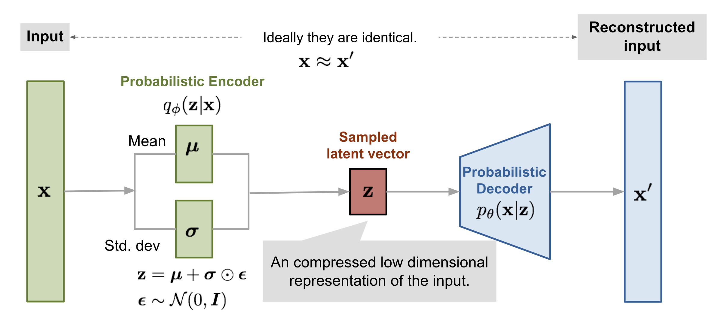
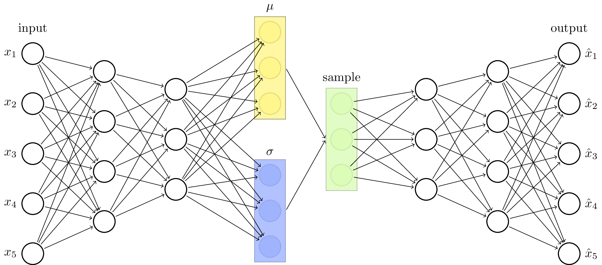

# Variational autoencoder  {#sec-vae .allowframebreaks}

## The original papers

-   Rezende, D. J., Mohamed, S., & Wierstra, D. (2014, June). Stochastic
    backpropagation and approximate inference in deep generative models.
    In International conference on machine learning (pp. 1278-1286).
    PMLR.

-   Kingma, D. P., & Welling, M. (2013). Auto-encoding variational
    bayes. arXiv preprint arXiv:1312.6114.

## Main reference

-   Diederik P. Kingma and Max Welling (2019), "An Introduction to
    Variational Autoencoders", Foundations and Trends R in Machine
    Learning:

## What it does

-   generate realistic samples of data,
-   allow for accurate imputations of missing data,
-   high-dimensional data visualisation
-   Clustering

## How it works

**Latent variables** models which marry ideas from

-   approximate Bayesian inference
    -   ELBO (Evidence Lower BOund)
    -   Reparametrization
-   deep neural networks
    -   Stochastic Gradient Descent
    -   Backpropagation

to represent an approximate posterior distribution through variational
lower bound optimization

## Auto-encoder Structure



## What is a VAE ?

### Coupling of 2 **parametric models**

A VAE is a latent variable model with a latent vector $\boldsymbol z$ and an observation
$\boldsymbol x \in \mathbb R^D$: $$
p(\boldsymbol x) = \int p(\boldsymbol x , \boldsymbol z)d\boldsymbol z
$$

-   encoder $g$ (recognition model): $p(\boldsymbol z| \boldsymbol x)$,
    which is approximated by $q_\Phi(\boldsymbol z| \boldsymbol x)$
-   decoder $h\approx g^{-1}$ (generative model):
    $p_\Theta(\boldsymbol x| \boldsymbol z)$
-   encoder and decoder could be neural networks

### Optimization of ELBO via Stochastic Gradient Ascent

-   The VAE ELBO approximates the likelihood of a **latent variable**
    model
-   The Gradient computation uses the re-parametrization trick
-   Each step of the gradient ascent augment the ELBO as an **EM
    iteration**

## Examples of use: Frey faces

### Original data and random generation

Left batch of original training set — right: random generation of
images.



### Learning from data



### New data generation from latent simulation



### Data representation in latent space



### Missing data imputation after learning



## Ingredient: Parameterization of conditional distributions with Neural Networks

## Modeling joint distribution

-   $\boldsymbol x$: Observed random variables
-   $p^*(\boldsymbol x)$ : underlying unknown distribution
-   $p_\theta(\boldsymbol x)$: model distribution
-   Goal: $p_\theta(\boldsymbol x) \approx p^*(\boldsymbol x)$

We wish flexible $p_\theta(\boldsymbol x)$

## Modeling Conditional distribution

### Classification and regression

$$
p_\theta (y | \boldsymbol x) \approx p^*(y | \boldsymbol x)
$$

## Parameterization of conditional distributions with Neural Networks

### Classification

$$\theta = NeuralNet(\boldsymbol x)$$

$$p_\theta (y | \boldsymbol x) = Categorical(y,\theta)$$

## Ingredient: Stochastic Gradient

## What differences between Oja's rule and VAE

### What is a VAE ?

Coupling of 2 **parametric models**

-   decoder (generative model): $\boldsymbol x=h_\Theta(\boldsymbol z)$
    where $p_\Theta(\boldsymbol x| \boldsymbol z)$
-   encoder (recognition model): $\boldsymbol z=g_\Phi(\boldsymbol x)$
    where $p(\boldsymbol z| \boldsymbol x)$ is approximated by
    $q_\Phi(\boldsymbol z| \boldsymbol x)$

### In Oja's rule

-   There are No probabilistic models
    -   $z=g(\boldsymbol x)=\boldsymbol w^T \boldsymbol x$ and
    -   $\hat{\boldsymbol x} = h(z)=z \boldsymbol w$,
-   Encoder and decoder share the same parameters $w=\Theta=\Phi$

## Factor analysis generalizes Oja and is closer to a VAE

Factor analysis considers the observation
$\boldsymbol x \in \mathbb R^D$\
$$
\boldsymbol x = \boldsymbol W \boldsymbol z + \boldsymbol \mu + \epsilon
$$ where

-   the noise
    $\epsilon \sim \mathcal N_D (\boldsymbol 0, \boldsymbol \Psi)$
-   the hidden (latent) vector
    $\boldsymbol z \sim \mathcal N_L (\boldsymbol 0, \boldsymbol I_L)$

$$
p(\boldsymbol x | \boldsymbol z, \theta) = \mathcal N (\boldsymbol x ; \boldsymbol W \boldsymbol z + \boldsymbol \mu, \boldsymbol \Psi)
$$ the mean is a linear function of the (hidden) inputs

-   $\boldsymbol W$ is a $D\times L$ matrix, known as the factor loading
    matrix,
-   $\boldsymbol \Psi$ is a $D\times D$ covariance matrix that we take
    to be diagonal

The special case in which $\boldsymbol \Psi=\sigma^2 I$ is called
probabilistic principal components analysis or PPCA.

## Ingredient : Evidence Lower BOund Minimization

## Missing data

In a missing data framework the log-likelihood of the parameters is
advantageously expressed as $$
log P_\Theta( \boldsymbol x) =  \mathbb E_{\boldsymbol z | \boldsymbol x}\left[ log \frac{P(\boldsymbol x,\boldsymbol z)}{P(\boldsymbol z | \boldsymbol x)}\right]
$$

### Approximation

When the distribution of $\boldsymbol z|\boldsymbol x$ is intractable,
an **approximation** $q_\Phi(\boldsymbol z|\boldsymbol x)$ is used

$q_\Phi(\boldsymbol z|\boldsymbol x)$ is the inverse function for
$p_\Theta(\boldsymbol x|\boldsymbol z)$ in a **Bayes sense**

## ELBO

```{=tex}
\begin{eqnarray*}
log P_\Theta( \boldsymbol x) &= &  \mathbb E_{q_\Phi(\boldsymbol z | \boldsymbol x)}\left[ log \frac{P_\Theta(\boldsymbol x,\boldsymbol z)}{P_\Theta(\boldsymbol z | \boldsymbol x)}\right]\\
&=& \mathbb E_{q_\Phi(\boldsymbol z | \boldsymbol x)}\left[ log \frac{P_\Theta (\boldsymbol x,\boldsymbol z) q_\Phi(\boldsymbol z | \boldsymbol x)}{P_\Theta (\boldsymbol z | \boldsymbol x)q_\Phi(\boldsymbol z | \boldsymbol x)}\right]\\
&= & \underbrace{\mathbb E_{q_\Phi(\boldsymbol z | \boldsymbol x)}\left[ log \frac{P_\Theta(\boldsymbol x,\boldsymbol z) }{q_\Phi(\boldsymbol z | \boldsymbol x)}\right]}_{ELBO} + \underbrace{\mathbb E_{q_\Phi(\boldsymbol z | \boldsymbol x)}\left[ log \frac{q_\Phi(\boldsymbol z|\boldsymbol x) }{p_\Theta(\boldsymbol z | \boldsymbol x)}\right]}_{D_{KL}(q_\Phi(\boldsymbol z|\boldsymbol x)| p_\Theta(\boldsymbol z|\boldsymbol x))}
\end{eqnarray*}
```
where
$D_{KL}(q_\Phi(\boldsymbol z|\boldsymbol x)\| p_\Theta(\boldsymbol z|\boldsymbol x)) = \mathbb E_q\!\left[\log{\frac{q}{p}}\right] \geq 0$
by Jensen's inequality, since $-\mathbb{E}_q[\log\frac{p}{q}] \geq -\log \mathbb{E}_q[\frac{p}{q}] = -\log 1 = 0$.

## Two for one

-   VAE finds parameters which approximately maximize the marginal
    likelihood $P_\Theta(\boldsymbol x)$ (good generative function)
-   VAE finds the approximation of the recognition model which minimizes
    the KL divergence


## Alternative formulation of ELBO

ELBO can be rewritten as 

$$
ELBO =  E_{q_\Phi(\boldsymbol z | \boldsymbol x)}\left[ log P_\Theta(\boldsymbol x|\boldsymbol z)\right]- D_{KL}(q_\Phi(\boldsymbol z|\boldsymbol x)| p_\Theta(\boldsymbol z))
$$
For a suited choice of $p(\boldsymbol z)$ and $q(\boldsymbol z| \boldsymbol x)$,  $D_{KL}(q_\Phi(\boldsymbol z|\boldsymbol x)| p_\Theta(\boldsymbol z))$ can be calculated in closed form.


## The ELBO is maximized by Stochastic Gradient

Let $\boldsymbol X$ be a i.i.d sample of random vector $\boldsymbol x$

$$
ELBO(\boldsymbol X) = \sum_{\boldsymbol x \in \boldsymbol X} \mathcal{L}(\Theta, \Phi;\boldsymbol x)
$$

### Gradient

The Gradient can be separated into 2 parts

1.  $\nabla_\Theta \mathcal{L}(\Theta, \Phi;\boldsymbol x)$
2.  $\nabla_\Phi \mathcal{L}(\Theta, \Phi;\boldsymbol x)$

## Decoder Gradient: $\nabla_\Theta \mathcal{L}(\Theta, \Phi;\boldsymbol x)$

Given some usually verified conditions and a Monte Carlo Approximation

```{=tex}
\begin{eqnarray*}
\nabla_\Theta \mathcal{L}(\Theta, \Phi;\boldsymbol x)&=& 
\nabla_\Theta  \mathbb E_{q_\Phi(\boldsymbol z | \boldsymbol x)}\left[ log \frac{P_\Theta(\boldsymbol x,\boldsymbol z) }{q_\Phi(\boldsymbol z | \boldsymbol x)}\right] \\
&=& 
\nabla_\Theta  \mathbb E_{q_\Phi(\boldsymbol z | \boldsymbol x)}\left[ \log P_\Theta(\boldsymbol x,\boldsymbol z)\right]\\
&=& 
 \mathbb E_{q_\Phi(\boldsymbol z | \boldsymbol x)}\left[ \nabla_\Theta  \log P_\Theta(\boldsymbol x,\boldsymbol z)\right]\\
&\approx&  \nabla_\Theta  \log P_\Theta(\boldsymbol x,\boldsymbol z)
\end{eqnarray*}
```
## Encoder Gradient: $\nabla_\Phi \mathcal{L}(\Theta, \Phi;\boldsymbol x)$

Encoder Gradient is more difficult to compute since in general
\begin{eqnarray*}
\nabla_\Phi \mathcal{L}(\Theta, \Phi;\boldsymbol x)&=& 
\nabla_\Phi  \mathbb E_{q_\Phi(\boldsymbol z | \boldsymbol x)}\left[ log \frac{P_\Theta(\boldsymbol x,\boldsymbol z) }{q_\Phi(\boldsymbol z | \boldsymbol x)}\right] \\
&=& 
\nabla_\Phi  \mathbb E_{q_\Phi(\boldsymbol z | \boldsymbol x)}\left[ \log P_\Theta(\boldsymbol x,\boldsymbol z) - \log q_\Phi(\boldsymbol z|\boldsymbol x)\right]\\
&\neq& 
  \mathbb E_{ q_\Phi(\boldsymbol z | \boldsymbol x)}\left[ \nabla_\Phi \log P_\Theta(\boldsymbol x,\boldsymbol z) - \nabla_\Phi \log q_\Phi(\boldsymbol z|\boldsymbol x)\right]
\end{eqnarray*}

A reparametrization (variable change) trick allows a workaround


## Encoder function

Let us rewrite the encoder function with a random vector
$\boldsymbol \epsilon$ whose distribution is not parametrized by $\Phi$:

$$
\boldsymbol z = g(\boldsymbol x, \boldsymbol \epsilon ; \Phi)
$$

```{=tex}
\begin{eqnarray*}
\nabla_\Phi \mathcal{L}(\Theta, \Phi;\boldsymbol x)&=& 
\nabla_\Phi  \mathbb E_{p(\boldsymbol \epsilon)}\left[ log \frac{P_\Theta(\boldsymbol x,\boldsymbol z) }{q_\Phi(\boldsymbol z | \boldsymbol x)}\right] \\
&=& 
\nabla_\Phi  \mathbb E_{p(\boldsymbol \epsilon )}\left[ \log P_\Theta(\boldsymbol x,\boldsymbol z) - \log q_\Phi(\boldsymbol z|\boldsymbol x)\right]\\
&=& 
  \mathbb E_{p(\boldsymbol \epsilon )} \left[ \nabla_\Phi \log P_\Theta(\boldsymbol x,\boldsymbol z) - \nabla_\Phi \log q_\Phi(\boldsymbol z|\boldsymbol x)\right]\\
&\approx&  \nabla_\Phi \log P_\Theta(\boldsymbol x,\boldsymbol z) - \nabla_\Phi \log q_\Phi(\boldsymbol z|\boldsymbol x)
\end{eqnarray*}
```
We just have to compute $\log q_\Phi(\boldsymbol z|\boldsymbol x)$ after
the change of variable

## Reparametrization trick



## Computing $\log q_\Phi(\boldsymbol z|\boldsymbol x)$ with a change of variable

$$
\log q_\Phi(\boldsymbol z|\boldsymbol x) = \log p(\boldsymbol \epsilon) - \log d_\Phi(\boldsymbol x, \boldsymbol \epsilon)
$$ where the second term is the log of the absolute value of the
determinant of the Jacobian matrix:

$$
\log d_\Phi(\boldsymbol x, \boldsymbol \epsilon) = \log
\left| 
\det
\begin{pmatrix}
\frac{\partial z_1}{\partial \epsilon_1} & \cdots & \frac{\partial z_1}{\partial \epsilon_k}\\
\vdots & \ddots & \vdots \\
\frac{\partial z_k}{\partial \epsilon_1} & \cdots & \frac{\partial z_k}{\partial \epsilon_k}\\
\end{pmatrix} 
\right|
$$

variable change $g()$ is chosen for the logdet being computationally
affordable/simple

## Factorized Gaussian Posterior

### Model

$$(\boldsymbol \mu, \log \boldsymbol \sigma^2) = EncoderNN_\Phi(\boldsymbol x)
$$

$$
q_\Phi (\boldsymbol  z | \boldsymbol x) = \mathcal N(\boldsymbol  z ; \boldsymbol  \mu, diag(\boldsymbol  \sigma^2) )
$$
$$q_\Phi (\boldsymbol  z | \boldsymbol x)=\prod_i q_\Phi(z_i | \boldsymbol x) =  \prod_i \mathcal N(z_i | EncoderNN_\Phi(\boldsymbol x)) = \prod_i \mathcal N(z_i | \mu_i, \sigma^2_i)
$$

### Reparametrization

$$
\boldsymbol \epsilon \sim \mathcal N(\boldsymbol 0, \boldsymbol I) 
$$ 

$$
\boldsymbol z = \boldsymbol \mu+ \boldsymbol \sigma \odot \boldsymbol \epsilon
$$

## Factorized Gaussian Posterior

The Jacobian of the transformation is 
$$
\log d_\Phi(\boldsymbol x, \boldsymbol \epsilon) = \log
\left| 
\det
\begin{pmatrix}
\frac{\partial z_1}{\partial \epsilon_1} & \cdots & \frac{\partial z_1}{\partial \epsilon_k}\\
\vdots & \ddots & \vdots \\
\frac{\partial z_k}{\partial \epsilon_1} & \cdots & \frac{\partial z_k}{\partial \epsilon_k}\\
\end{pmatrix} 
\right| = \log \prod_i \sigma_i
$$

The log posterior density is

```{=tex}
\begin{eqnarray*}
\log q_\Phi (\boldsymbol z | \boldsymbol x) &=& \log p(\boldsymbol \epsilon)  - \log |det(\frac{\partial \boldsymbol z}{\partial \boldsymbol \epsilon})|\\
&=&  \sum_i \log \mathcal N(\epsilon_i ;0,1) - \log \sigma_i
\end{eqnarray*}
```
## Reparametrization trick



## Full Gaussian posterior

### Model

$$
q_\Phi (\boldsymbol  z | \boldsymbol x) = \mathcal N(\boldsymbol  z ; \boldsymbol  \mu, \boldsymbol  \Sigma )
$$


### Reparametrization

$$
\boldsymbol \epsilon \sim \mathcal N(\boldsymbol 0, \boldsymbol I) 
$$ 

$$
\boldsymbol z = \boldsymbol \mu+ \boldsymbol L  \boldsymbol \epsilon
$$
Where $\boldsymbol L$ is a lower triangular matrix obtained from a Cholesky decompostion of $\boldsymbol \Sigma = \boldsymbol L \boldsymbol L^T$


## Full Gaussian posterior

The Jacobian has a simple form

$$
\frac{\partial \boldsymbol z}{\partial \boldsymbol \epsilon} = \boldsymbol L
$$

As the determinant of a triangular matrix is  the product of its diagonal terms, 

```{=tex}
\begin{eqnarray*}
\log q_\Phi (\boldsymbol z | \boldsymbol x) &=& \log p(\boldsymbol \epsilon)  - \log |det(\frac{\partial \boldsymbol z}{\partial \boldsymbol \epsilon})|\\
&=&  \sum_i \log \mathcal N(\epsilon_i ;0,1) - \log L_{ii}
\end{eqnarray*}
```


## Algorithm input and output

Input:

-   $\boldsymbol X$: Dataset
-   $h(\boldsymbol z)$ decoding function, with dist.
    $p_\Theta(\boldsymbol x, \boldsymbol z)$\
-   $g(\boldsymbol x)$ encoding function with dist.
    $q_\Phi(\boldsymbol z | \boldsymbol x)$

Output:

-   $\Theta$
-   $\Phi$

## Algorithm

Initialisation of $\Theta$ and $\Phi$

While SGD not converged do

-   Draw a random minibatch $\boldsymbol X^M \in \boldsymbol X$\
-   $\boldsymbol \epsilon \sim p(\boldsymbol \epsilon)$ (Random noise
    for every datapoint in $\boldsymbol X^M$)
-   Compute
    -   $\tilde{\mathcal L}_{\Theta, \Phi}(\boldsymbol X^M, \boldsymbol \epsilon)=\frac{1}{m}\sum_{\boldsymbol x \in \boldsymbol X^M} \left({\log p_\Theta(\boldsymbol x, \boldsymbol z) - \underbrace{\log q_\Phi(\boldsymbol z|\boldsymbol x)}_{\log p(\epsilon) -\log d_\Phi(\boldsymbol x,\boldsymbol \epsilon)}} \right)$
        and
    -   its gradients
        -   $\nabla_\Theta \tilde{\mathcal L}_{\Theta, \Phi}(\boldsymbol X^M, \boldsymbol \epsilon) = \frac{1}{m}\sum_{\boldsymbol x \in \boldsymbol X^M} \frac{\partial \log p_\Theta(\boldsymbol x, \boldsymbol z)}{\partial \Theta}$
        -   $\nabla_\Phi \tilde{\mathcal L}_{\Theta, \Phi}(\boldsymbol X^M, \boldsymbol \epsilon) = \frac{1}{m}\sum_{\boldsymbol x \in \boldsymbol X^M} \frac{\partial \log d_\Phi(\boldsymbol x, \boldsymbol \epsilon)}{\partial \Phi}$
-   $\begin{pmatrix}\Theta \\ \Phi\end{pmatrix} := \begin{pmatrix}\Theta \\ \Phi\end{pmatrix} + \eta \begin{pmatrix}\nabla_\Theta \tilde{\mathcal L}_{\Theta, \Phi}(\boldsymbol X^M, \boldsymbol \epsilon) \\ \nabla_\Phi \tilde{\mathcal L}_{\Theta, \Phi}(\boldsymbol X^M, \boldsymbol \epsilon) \end{pmatrix}$

## Original example from Kingma: Gaussian model with MLP parametrization

### Multivariate Gaussian decoder with a diagonal covariance structure

Decoder $p_\Theta(\boldsymbol x| \boldsymbol z)$ or encoder (just swap
$\boldsymbol x$ and $\boldsymbol z$) are assumed to have multivariate
Gaussian dist. with a diagonal covariance structure:

### Decoder

-   $log p(x|z) = \log \mathcal N (\boldsymbol x; \boldsymbol \mu, \sigma^2 I)$
    where $\boldsymbol \mu = W_4 \boldsymbol h+b_4$
-   $\log\sigma^2 =W_5 \boldsymbol h+b_5$
-   $\boldsymbol h = \tanh (W_3\boldsymbol z + b_3)$

where $\{W_3, W_4, W_5, b_3, b_4, b_5\}$ are the weights and biases of
the MLP and part of $\Theta$ when used as decoder.

### Encoder

-   Let us consider the prior
    $p_\Theta(\boldsymbol z) = \mathcal N(0,I)$
-   swap $\boldsymbol x$ and $\boldsymbol z$ in the decoder above to get
    $q_\Phi(\boldsymbol z| \boldsymbol x)$

## Gaussian VAE illustrated



## Bernoulli decoder for binary data

When the observed data $\boldsymbol x$ consists of binary values (e.g. binarized images like MNIST), a Bernoulli decoder is more appropriate than a Gaussian one.

### Model

The decoder outputs a probability vector $\boldsymbol \pi \in [0,1]^D$ via a sigmoid activation:

$$
\boldsymbol \pi = \sigma(W_4 \boldsymbol h + b_4), \quad \boldsymbol h = \tanh(W_3 \boldsymbol z + b_3)
$$

The likelihood of a single observation is:
$$
p_\Theta(\boldsymbol x | \boldsymbol z) = \prod_{d=1}^{D} \pi_d^{x_d}(1-\pi_d)^{1-x_d}
$$

### Reconstruction loss

The negative log-likelihood gives the **binary cross-entropy** loss:
$$
-\log p_\Theta(\boldsymbol x | \boldsymbol z) = -\sum_{d=1}^{D} \left[ x_d \log \pi_d + (1-x_d) \log(1-\pi_d) \right]
$$

This is the reconstruction term that appears in the ELBO for binary data, replacing the squared error term of the Gaussian decoder.


## The concrete VAE loss function

### From ELBO to loss

Maximizing the ELBO is equivalent to minimizing the following loss for a single data point $\boldsymbol x$:
$$
\mathcal{L}(\Theta, \Phi; \boldsymbol x) = \underbrace{-\mathbb{E}_{q_\Phi(\boldsymbol z | \boldsymbol x)}\!\left[\log p_\Theta(\boldsymbol x | \boldsymbol z)\right]}_{\text{Reconstruction loss}} + \underbrace{D_{KL}\!\left(q_\Phi(\boldsymbol z | \boldsymbol x) \| p(\boldsymbol z)\right)}_{\text{KL regularization}}
$$

For a dataset $\boldsymbol X = \{\boldsymbol x_1, \ldots, \boldsymbol x_N\}$, the total loss is $\sum_{i=1}^N \mathcal{L}(\Theta, \Phi; \boldsymbol x_i)$.

### Reconstruction loss

The reconstruction term depends on the decoder distribution:

- **Gaussian decoder** (continuous data): $-\log p_\Theta(\boldsymbol x | \boldsymbol z) \propto \|\boldsymbol x - \boldsymbol \mu_\Theta(\boldsymbol z)\|^2$ (mean squared error)
- **Bernoulli decoder** (binary data): $-\log p_\Theta(\boldsymbol x | \boldsymbol z) = -\sum_d \left[x_d \log \pi_d + (1-x_d)\log(1-\pi_d)\right]$ (binary cross-entropy)

### KL term (closed form)

With the standard choices $q_\Phi(\boldsymbol z | \boldsymbol x) = \mathcal{N}(\boldsymbol \mu, \text{diag}(\boldsymbol \sigma^2))$ and $p(\boldsymbol z) = \mathcal{N}(\boldsymbol 0, \boldsymbol I)$, the KL divergence has a closed-form expression (see exercises):
$$
D_{KL} = -\frac{1}{2}\sum_{j=1}^{L}\left(1 + \log \sigma_j^2 - \mu_j^2 - \sigma_j^2\right)
$$

## $\beta$-VAE and variants

### $\beta$-VAE

$\beta$-VAE (Higgins et al., 2017) introduces a hyperparameter $\beta$ that controls the trade-off between reconstruction and regularization:
$$
\mathcal{L}_\beta = -\mathbb{E}_{q_\Phi(\boldsymbol z | \boldsymbol x)}\!\left[\log p_\Theta(\boldsymbol x | \boldsymbol z)\right] + \beta \cdot D_{KL}\!\left(q_\Phi(\boldsymbol z | \boldsymbol x) \| p(\boldsymbol z)\right)
$$

- $\beta > 1$: stronger regularization, encouraging more **disentangled** latent representations (each latent dimension captures an independent factor of variation)
- $\beta < 1$: better reconstruction at the cost of less structured latent space
- $\beta = 1$: standard VAE

### Other notable variants

- **Conditional VAE (CVAE)**: conditions both encoder and decoder on a label $y$, enabling class-specific generation: $p_\Theta(\boldsymbol x | \boldsymbol z, y)$ and $q_\Phi(\boldsymbol z | \boldsymbol x, y)$.
- **VQ-VAE** (van den Oord et al., 2017): replaces the continuous latent space with a discrete codebook of learned embeddings. The encoder output is quantized to its nearest codebook entry. This avoids posterior collapse and produces high-quality discrete representations.


