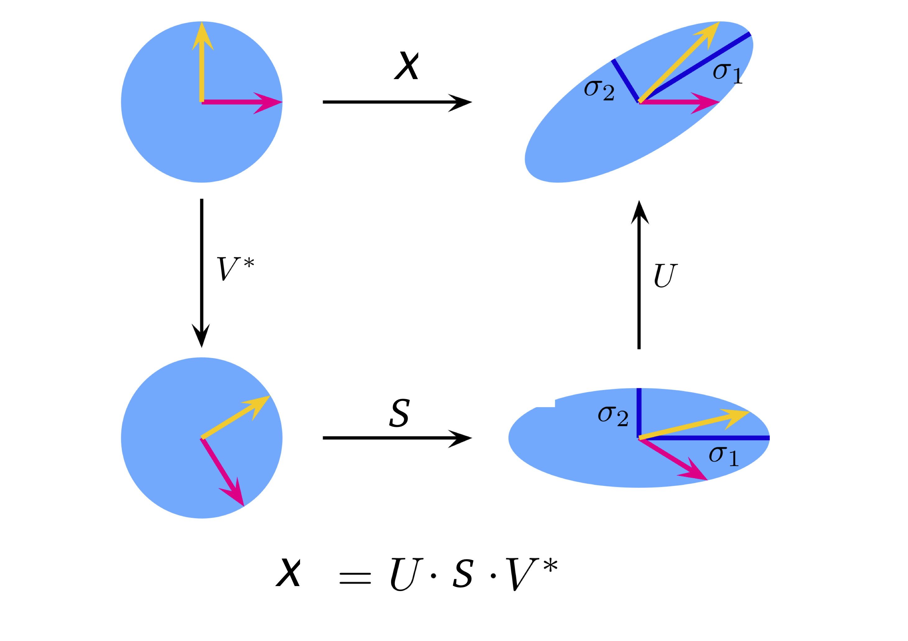





<!-- 
# SVD — Definition and Existence

## Eigendecomposition of symmetric matrices

$\forall \boldsymbol A \in \mathbb{R}^{n\times n}$ symmetric, there exist an orthonormal matrix $\boldsymbol Q \in \mathbb{R}^{n\times n}$ and a diagonal matrix $\boldsymbol\Lambda = \mathrm{diag}(\lambda_1, \cdots, \lambda_n)$ such that:

$$
\boldsymbol A = \boldsymbol Q \boldsymbol\Lambda \boldsymbol Q^T
$$

## Singular Value Decomposition

Extends eigendecomposition to **rectangular matrices** $\boldsymbol X \in \mathbb{R}^{n\times d}$:

$$
\boldsymbol X = \boldsymbol U \boldsymbol S \boldsymbol V^T
$$

- $\boldsymbol U \in \mathbb{R}^{n\times n}$, $\boldsymbol V \in \mathbb{R}^{d\times d}$ orthogonal ($\boldsymbol U^T\boldsymbol U = \boldsymbol I$, $\boldsymbol V^T\boldsymbol V = \boldsymbol I$)
- $\boldsymbol S \in \mathbb{R}^{n\times d}$ non-negative "diagonal": singular values $\sigma_1 \geq \cdots \geq \sigma_r > 0$

**Vector form:** $\displaystyle\boldsymbol X = \sum_{j=1}^r \sigma_j \boldsymbol u_j \boldsymbol v_j^T$ where $r = \mathrm{rank}(\boldsymbol X)$

## Full vs. economy SVD

**Full SVD:**
$$
\boldsymbol X_{n\times d} = \boldsymbol U_{n\times n}\, \boldsymbol S_{n\times d}\, \boldsymbol V_{d\times d}^T
$$

**Economy (thin) SVD** — keep only the $r$ non-zero singular values:
$$
\boldsymbol X_{n\times d} = \boldsymbol U_{n\times r}\, \boldsymbol S_{r\times r}\, \boldsymbol V_{r\times d}^T
$$

{width=60%}

## Geometrical interpretation

A matrix $\boldsymbol X$ defines a linear map $f(\boldsymbol x) = \boldsymbol X\boldsymbol x$. The SVD decomposes it into three operations:

$$
\underbrace{\boldsymbol X}_{\text{linear map}}\, \boldsymbol x =
\underbrace{\boldsymbol U}_{\text{rotation}}
\underbrace{\boldsymbol S}_{\text{scaling}}
\underbrace{\boldsymbol V^T}_{\text{rotation}} \boldsymbol x
$$

## Existence — construction

Given $\boldsymbol X \in \mathbb{R}^{n\times d}$, let $\boldsymbol X^T\boldsymbol X = \boldsymbol V\boldsymbol\Lambda\boldsymbol V^T$ with $\lambda_1 \geq \cdots \geq \lambda_r > 0 = \lambda_{r+1} = \cdots$

Define singular values $\sigma_i = \sqrt{\lambda_i}$ and left singular vectors:
$$
\boldsymbol u_i = \frac{1}{\sigma_i}\boldsymbol X\boldsymbol v_i \in \mathbb{R}^n, \quad 1 \leq i \leq r
$$

Complete $\{\boldsymbol u_1,\ldots,\boldsymbol u_r\}$ to a full orthonormal basis $\boldsymbol U$ of $\mathbb{R}^n$.

Then $\boldsymbol X\boldsymbol V = \boldsymbol U\boldsymbol S$, i.e. $\boldsymbol X = \boldsymbol U\boldsymbol S\boldsymbol V^T$. $\square$

---

## Exercise: Orthonormality of the left singular vectors

::: {.callout-note title="Exercise"}
With $\boldsymbol u_i = \frac{1}{\sigma_i}\boldsymbol X\boldsymbol v_i$ and $\boldsymbol X^T\boldsymbol X = \boldsymbol V\boldsymbol\Lambda\boldsymbol V^T$:

1. Show that $\boldsymbol u_i^T\boldsymbol u_j = \delta_{ij}$ (the $\boldsymbol u_i$ are orthonormal).
2. Show that $\boldsymbol X\boldsymbol v_i = \sigma_i\boldsymbol u_i$ for $i \leq r$ and $\boldsymbol X\boldsymbol v_i = \boldsymbol 0$ for $i > r$.
:::

## Solution: Orthonormality (1/2)

**Part 1 — Orthonormality of $\boldsymbol u_1,\ldots,\boldsymbol u_r$.**

Direct computation:
$$
\boldsymbol u_i^T\boldsymbol u_j
= \frac{1}{\sigma_i\sigma_j}(\boldsymbol X\boldsymbol v_i)^T(\boldsymbol X\boldsymbol v_j)
= \frac{1}{\sigma_i\sigma_j}\boldsymbol v_i^T \underbrace{\boldsymbol X^T\boldsymbol X}_{=\boldsymbol V\boldsymbol\Lambda\boldsymbol V^T} \boldsymbol v_j
$$

Since columns of $\boldsymbol V$ are orthonormal, $\boldsymbol V^T\boldsymbol v_j = \boldsymbol e_j$, so:
$$
\boldsymbol u_i^T\boldsymbol u_j
= \frac{1}{\sigma_i\sigma_j}\boldsymbol e_i^T\boldsymbol\Lambda\boldsymbol e_j
= \frac{\lambda_j}{\sigma_i\sigma_j}\delta_{ij}
= \frac{\sigma_j^2}{\sigma_i\sigma_j}\delta_{ij} = \delta_{ij}. \quad \square
$$

## Solution: Orthonormality (2/2)

**Part 2 — Relation $\boldsymbol X\boldsymbol v_i = \sigma_i\boldsymbol u_i$.**

**For $i \leq r$:** by definition $\boldsymbol u_i = \frac{1}{\sigma_i}\boldsymbol X\boldsymbol v_i$, so immediately $\boldsymbol X\boldsymbol v_i = \sigma_i\boldsymbol u_i$.

**For $i > r$:** $\boldsymbol v_i$ lies in the kernel of $\boldsymbol X^T\boldsymbol X$ (since $\lambda_i = 0$), so:
$$
\|\boldsymbol X\boldsymbol v_i\|^2 = \boldsymbol v_i^T\boldsymbol X^T\boldsymbol X\boldsymbol v_i = \boldsymbol v_i^T \cdot \boldsymbol 0 = 0
$$
which implies $\boldsymbol X\boldsymbol v_i = \boldsymbol 0$. $\square$

---

# Properties of the SVD

## Properties

Let $\boldsymbol X \in \mathbb{R}^{n\times d}$ with SVD $\boldsymbol X = \boldsymbol U\boldsymbol S\boldsymbol V^T$ and $r = \mathrm{rank}(\boldsymbol X)$:

- $\mathrm{rank}(\boldsymbol X) = r$ = number of strictly positive singular values
- $\ker(\boldsymbol X) = \mathrm{span}(\boldsymbol v_{r+1}, \ldots, \boldsymbol v_d)$
- $\mathrm{range}(\boldsymbol X) = \mathrm{span}(\boldsymbol u_1, \ldots, \boldsymbol u_r)$

**Duality:**
$$
\boldsymbol X^T\boldsymbol X = \boldsymbol V\boldsymbol\Lambda\boldsymbol V^T
\quad\Rightarrow\quad
\text{columns of } \boldsymbol V \text{ are eigenvectors of } \boldsymbol X^T\boldsymbol X
$$
$$
\boldsymbol X\boldsymbol X^T = \boldsymbol U\boldsymbol\Lambda'\boldsymbol U^T
\quad\Rightarrow\quad
\text{columns of } \boldsymbol U \text{ are eigenvectors of } \boldsymbol X\boldsymbol X^T
$$

## Exercise: Properties of the SVD

::: {.callout-note title="Exercise"}
Let $\boldsymbol X \in \mathbb{R}^{n\times d}$ with SVD $\boldsymbol X = \boldsymbol U\boldsymbol S\boldsymbol V^T$ and $r = \mathrm{rank}(\boldsymbol X)$.

1. Show that $\mathrm{rank}(\boldsymbol X) = r$ equals the number of strictly positive singular values.
2. Identify $\ker(\boldsymbol X)$.
3. Identify $\mathrm{range}(\boldsymbol X)$.
4. Show that $\boldsymbol X^T\boldsymbol X = \boldsymbol V\boldsymbol\Lambda\boldsymbol V^T$ and $\boldsymbol X\boldsymbol X^T = \boldsymbol U\boldsymbol\Lambda'\boldsymbol U^T$.
:::

## Solution: Properties (1/2)

**1. Rank.** Since $\boldsymbol U$, $\boldsymbol V$ are invertible: $\mathrm{rank}(\boldsymbol X) = \mathrm{rank}(\boldsymbol S)$. $\boldsymbol S$ is diagonal with $r$ non-zero entries, so $\mathrm{rank}(\boldsymbol S) = r$. $\square$

**2. Kernel.** Write $\boldsymbol x = \boldsymbol V\boldsymbol\alpha$ (since $\boldsymbol V$ is a basis of $\mathbb{R}^d$):
$$
\boldsymbol X\boldsymbol x = \boldsymbol U\boldsymbol S\underbrace{\boldsymbol V^T\boldsymbol V}_{=\boldsymbol I}\boldsymbol\alpha = \boldsymbol U\boldsymbol S\boldsymbol\alpha = \boldsymbol 0
\iff \boldsymbol S\boldsymbol\alpha = \boldsymbol 0 \iff \alpha_1 = \cdots = \alpha_r = 0
$$
Therefore $\ker(\boldsymbol X) = \mathrm{span}(\boldsymbol v_{r+1},\ldots,\boldsymbol v_d)$. $\square$

## Solution: Properties (2/2)

**3. Range.** For any $\boldsymbol x$, set $\boldsymbol\alpha = \boldsymbol V^T\boldsymbol x$:
$$
\boldsymbol X\boldsymbol x = \boldsymbol U\boldsymbol S\boldsymbol\alpha = \sum_{i=1}^r \sigma_i\alpha_i\boldsymbol u_i
\quad\Rightarrow\quad
\mathrm{range}(\boldsymbol X) = \mathrm{span}(\boldsymbol u_1,\ldots,\boldsymbol u_r). \quad\square
$$

**4. Gram matrices.**
$$
\boldsymbol X^T\boldsymbol X
= \boldsymbol V\boldsymbol S^T\underbrace{\boldsymbol U^T\boldsymbol U}_{=\boldsymbol I}\boldsymbol S\boldsymbol V^T
= \boldsymbol V\underbrace{\boldsymbol S^T\boldsymbol S}_{=\boldsymbol\Lambda}\boldsymbol V^T
$$
$$
\boldsymbol X\boldsymbol X^T
= \boldsymbol U\boldsymbol S\underbrace{\boldsymbol V^T\boldsymbol V}_{=\boldsymbol I}\boldsymbol S^T\boldsymbol U^T
= \boldsymbol U\underbrace{\boldsymbol S\boldsymbol S^T}_{=\boldsymbol\Lambda'}\boldsymbol U^T \quad\square
$$

---

# Low-Rank Approximation

## Frobenius norm

The Frobenius norm of $\boldsymbol X$ satisfies:
$$
\|\boldsymbol X\|_F^2 = \sum_{ij} X_{ij}^2 = \mathrm{trace}(\boldsymbol X^T\boldsymbol X) = \sum_{j=1}^r \sigma_j^2
$$

**Rank-$k$ truncated SVD:**
$$
\hat{\boldsymbol X}_k = \sum_{j=1}^k \sigma_j\boldsymbol u_j\boldsymbol v_j^T
$$

**Residual:**
$$
\|\boldsymbol X - \hat{\boldsymbol X}_k\|_F^2 = \sum_{j=k+1}^r \sigma_j^2
$$

## Eckart–Young theorem

$$
\hat{\boldsymbol X}_k = \arg\min_{\hat{\boldsymbol X}\,:\,\mathrm{rank}(\hat{\boldsymbol X})=k} \|\boldsymbol X - \hat{\boldsymbol X}\|_F^2
$$

**Proof sketch.** For any rank-$k$ matrix $\boldsymbol Y_k$, spectral norm sub-additivity gives:
$$
\sigma_i(\boldsymbol X - \boldsymbol Y_k) + \underbrace{\sigma_{k+1}(\boldsymbol Y_k)}_{=0} \geq \sigma_{i+k}(\boldsymbol X)
$$
Summing squares over $i$:
$$
\|\boldsymbol X - \boldsymbol Y_k\|_F^2 = \sum_i \sigma_i(\boldsymbol X - \boldsymbol Y_k)^2 \geq \sum_{j=k+1}^r \sigma_j^2 = \|\boldsymbol X - \hat{\boldsymbol X}_k\|_F^2. \quad\square
$$

## Exercise: Low-rank approximation and Frobenius norm

::: {.callout-note title="Exercise"}
Let $\hat{\boldsymbol X}_k = \sum_{j=1}^k \sigma_j\boldsymbol u_j\boldsymbol v_j^T$.

1. Show that $\|\boldsymbol X\|_F^2 = \sum_{j=1}^r \sigma_j^2$.
2. Show that $\|\boldsymbol X - \hat{\boldsymbol X}_k\|_F^2 = \sum_{j=k+1}^r \sigma_j^2$.
3. Using the inequality $\sigma_i(\boldsymbol X - \boldsymbol Y_k) \geq \sigma_{i+k}(\boldsymbol X)$ (spectral sub-additivity), prove that $\hat{\boldsymbol X}_k$ is optimal (Eckart–Young theorem).
:::

## Solution: Frobenius norm (1/2)

**Part 1 — $\|\boldsymbol X\|_F^2 = \sum_j\sigma_j^2$.**

Using the cyclic property of the trace:
$$
\|\boldsymbol X\|_F^2
= \mathrm{trace}(\boldsymbol X^T\boldsymbol X)
= \mathrm{trace}(\boldsymbol V\boldsymbol\Lambda\boldsymbol V^T)
= \mathrm{trace}(\boldsymbol\Lambda\underbrace{\boldsymbol V^T\boldsymbol V}_{=\boldsymbol I})
= \mathrm{trace}(\boldsymbol\Lambda)
= \sum_{j=1}^r\sigma_j^2. \quad\square
$$

**Part 2 — $\|\boldsymbol X - \hat{\boldsymbol X}_k\|_F^2 = \sum_{j>k}\sigma_j^2$.**

The residual is $\boldsymbol X - \hat{\boldsymbol X}_k = \sum_{j=k+1}^r\sigma_j\boldsymbol u_j\boldsymbol v_j^T$. The rank-1 matrices are Frobenius-orthogonal:
$$
\langle \sigma_i\boldsymbol u_i\boldsymbol v_i^T,\, \sigma_j\boldsymbol u_j\boldsymbol v_j^T\rangle_F
= \sigma_i\sigma_j\,\mathrm{trace}(\boldsymbol v_i\underbrace{\boldsymbol u_i^T\boldsymbol u_j}_{=\delta_{ij}}\boldsymbol v_j^T)
= \sigma_i^2\,\delta_{ij}
$$
Therefore $\|\boldsymbol X - \hat{\boldsymbol X}_k\|_F^2 = \sum_{j=k+1}^r\sigma_j^2$. $\square$

## Solution: Frobenius norm (2/2)

**Part 3 — Eckart–Young optimality.**

For any rank-$k$ matrix $\boldsymbol Y_k$, we have $\sigma_{k+1}(\boldsymbol Y_k) = 0$. Spectral sub-additivity applied to $\boldsymbol X = (\boldsymbol X - \boldsymbol Y_k) + \boldsymbol Y_k$ gives for $i \geq 1$:
$$
\sigma_i(\boldsymbol X - \boldsymbol Y_k) + \underbrace{\sigma_{k+1}(\boldsymbol Y_k)}_{=0} \geq \sigma_{i+k}(\boldsymbol X)
\quad\Rightarrow\quad
\sigma_i(\boldsymbol X - \boldsymbol Y_k) \geq \sigma_{i+k}(\boldsymbol X).
$$

Summing the squares:
$$
\|\boldsymbol X - \boldsymbol Y_k\|_F^2
= \sum_{i=1}^n \sigma_i(\boldsymbol X - \boldsymbol Y_k)^2
\geq \sum_{i=1}^{n-k}\sigma_{i+k}(\boldsymbol X)^2
= \sum_{j=k+1}^r\sigma_j^2
= \|\boldsymbol X - \hat{\boldsymbol X}_k\|_F^2. \quad\square
$$

## Toy example in R

```{r}
#| echo: true
X <- matrix(1:12, 4, 3, byrow = TRUE)
X.svd <- svd(X)
k <- 2
cat("Original matrix:\n"); print(X)
cat("\nSingular values:", round(X.svd$d, 4), "\n")
cat("\nRank-2 approximation:\n")
print(round(X.svd$u[, 1:k] %*% diag(X.svd$d[1:k]) %*%
            t(X.svd$v[, 1:k]), 4))
```

## Application: image compression (setup)

SVD applied channel by channel to a 512×512 colour image.

```{r}
#| echo: true
pkgs <- c("tiff", "rasterImage")
new_pkgs <- pkgs[!sapply(pkgs, requireNamespace, quietly = TRUE)]
if (length(new_pkgs)) install.packages(new_pkgs)
invisible(lapply(pkgs, library, character.only = TRUE))

svd_image <- function(im, k) {
  s   <- svd(im)
  im_k <- s$u[, 1:k] %*% diag(s$d[1:k], k) %*% t(s$v[, 1:k])
  im_k[im_k > 1] <- 1
  im_k[im_k < 0] <- 0
  im_k
}

peppers <- readTIFF("../data/Peppers.tiff")
cat("Image dimensions:", dim(peppers), "\n")
```

## Application: image compression (result)

```{r}
#| echo: true
#| out-width: "100%"
par(mfrow = c(2, 2), mar = c(1, 1, 1.5, 1))
for (k in c(4, 30, 100, 300)) {
  app <- peppers
  for (ch in 1:3) app[,, ch] <- svd_image(peppers[,, ch], k)
  plot(as.raster(app), main = paste("rank k =", k))
}
```

---

# SVD and PCA

## Low-rank approximation as projection

If $E_k = \mathrm{span}(\boldsymbol u_1,\ldots,\boldsymbol u_k)$ with projector $\Pi_{E_k} = \boldsymbol U_{E_k}\boldsymbol U_{E_k}^T$:

$$
\|\boldsymbol X - \hat{\boldsymbol X}\|_F^2 = \|\Pi_{E_k^\perp}\boldsymbol X\|_F^2
$$

**Decomposition of inertia:**
$$
\|\boldsymbol X\|_F^2
= \underbrace{\|\Pi_{E_k}\boldsymbol X\|_F^2}_{\text{explained inertia}}
+ \underbrace{\|\Pi_{E_k^\perp}\boldsymbol X\|_F^2}_{\text{residual}}
$$

PCA **maximises** projected inertia $\Longleftrightarrow$ **minimises** reconstruction error.

## Principal components and explained variance

**$\boldsymbol X$ centered.** The $k$ first principal component scores:
$$
\boldsymbol C_{1:n,1:k} = \boldsymbol X\boldsymbol V_{1:d,1:k} = \boldsymbol U_{E_k}\boldsymbol S_{1:k,1:k}
$$

Fraction of variance explained by the first $k$ components:
$$
\mathrm{PVE}(k) = \frac{\sum_{j=1}^k \sigma_j^2}{\sum_{j=1}^d \sigma_j^2} \in [0,1]
$$

Correlation of variable $j$ with component $k$:
$$
\widehat{\mathrm{cor}}(\boldsymbol X_{\bullet,j},\, \boldsymbol C_{\bullet,k}) = \cos\angle(\boldsymbol X_{\bullet,j},\boldsymbol C_{\bullet,k})
$$

## Exercise: SVD and PCA

::: {.callout-note title="Exercise"}
Let $\boldsymbol X \in \mathbb{R}^{n\times d}$ be centered with SVD $\boldsymbol X = \boldsymbol U\boldsymbol S\boldsymbol V^T$.

1. Show that $\hat{\boldsymbol\Sigma} = \frac{1}{n}\boldsymbol X^T\boldsymbol X = \frac{1}{n}\boldsymbol V\boldsymbol S^T\boldsymbol S\boldsymbol V^T$. Conclude that the right singular vectors $\boldsymbol v_j$ are the PCA principal directions.
2. Let $\boldsymbol C = \boldsymbol X\boldsymbol V$. Show that $\boldsymbol C = \boldsymbol U\boldsymbol S$ and that columns of $\boldsymbol C$ are orthogonal with $\|\boldsymbol C_{\bullet,k}\|^2 = \sigma_k^2$.
3. Express $\mathrm{PVE}(k)$ in terms of singular values.
:::

## Solution: SVD and PCA (1/2)

**Part 1 — Covariance and principal directions.**

Since $\boldsymbol X$ is centered, $\hat{\boldsymbol\Sigma} = \frac{1}{n}\boldsymbol X^T\boldsymbol X$. Substituting the SVD:
$$
\hat{\boldsymbol\Sigma}
= \frac{1}{n}\boldsymbol V\boldsymbol S^T\boldsymbol S\boldsymbol V^T
= \boldsymbol V\,\mathrm{diag}\!\left(\frac{\sigma_1^2}{n},\ldots,\frac{\sigma_d^2}{n}\right)\boldsymbol V^T.
$$
This is the eigendecomposition of $\hat{\boldsymbol\Sigma}$: eigenvalues $\lambda_j = \sigma_j^2/n$, eigenvectors $\boldsymbol v_j$. The PCA principal directions coincide with the right singular vectors of $\boldsymbol X$. $\square$

**Part 2 — Scores.**
$$
\boldsymbol C = \boldsymbol X\boldsymbol V = \boldsymbol U\boldsymbol S\underbrace{\boldsymbol V^T\boldsymbol V}_{=\boldsymbol I} = \boldsymbol U\boldsymbol S.
$$
Orthogonality: $\boldsymbol C^T\boldsymbol C = \boldsymbol S^T\underbrace{\boldsymbol U^T\boldsymbol U}_{=\boldsymbol I}\boldsymbol S = \mathrm{diag}(\sigma_1^2,\ldots,\sigma_r^2,0,\ldots)$, so $\|\boldsymbol C_{\bullet,k}\|^2 = \sigma_k^2$. $\square$

## Solution: SVD and PCA (2/2)

**Part 3 — PVE.**

Total variance: $\|\boldsymbol X\|_F^2 = \sum_{j=1}^r\sigma_j^2$.

Variance captured by first $k$ components: $\|\boldsymbol C_{\bullet,1:k}\|_F^2 = \sum_{j=1}^k\sigma_j^2$.

$$
\mathrm{PVE}(k) = \frac{\sum_{j=1}^k\sigma_j^2}{\sum_{j=1}^r\sigma_j^2} \in [0,1]. \quad\square
$$

---

# Practice: SVD on Real Data

## Exercise: SVD in practice with R

::: {.callout-note title="Exercise"}
Apply SVD to `USArrests` (50 US states × 4 variables: `Murder`, `Assault`, `Rape`, `UrbanPop`):

1. Standardise the data and compute the SVD. Report singular values and variance explained.
2. Compute rank-1 and rank-2 approximations; verify $\|\boldsymbol X - \hat{\boldsymbol X}_k\|_F^2 = \sum_{j>k}\sigma_j^2$.
3. Draw the biplot: state scores + variable loading arrows for PC1 and PC2.
:::

## Solution: step 1 — SVD and variance explained

```{r}
#| echo: true
X     <- scale(USArrests)       # center + scale
X.svd <- svd(X)
sigma <- X.svd$d

cat("Singular values:\n")
print(round(sigma, 3))

var_exp <- sigma^2 / sum(sigma^2)
cat("\nVariance explained (%):\n")
print(round(100 * var_exp, 1))

cat("Cumulative (%):\n")
print(round(100 * cumsum(var_exp), 1))
```

## Solution: step 2 — low-rank reconstruction

```{r}
#| echo: true
low_rank <- function(s, k) {
  s$u[, 1:k, drop = FALSE] %*%
    diag(s$d[1:k], nrow = k) %*%
    t(s$v[, 1:k, drop = FALSE])
}

for (k in 1:2) {
  Xhat       <- low_rank(X.svd, k)
  err_num    <- sum((X - Xhat)^2)
  err_theory <- sum(sigma[-(1:k)]^2)
  cat(sprintf(
    "k = %d  ||X - Xhat||_F^2 = %.4f   (theory: %.4f)\n",
    k, err_num, err_theory
  ))
}
```

## Solution: step 3 — biplot

```{r}
#| echo: true
#| fig-width: 9
#| fig-height: 6
scores   <- X.svd$u[, 1:2] %*% diag(X.svd$d[1:2])
loadings <- X.svd$v[, 1:2]

plot(scores, type = "n",
     xlab = sprintf("PC1 (%.1f%%)", 100 * var_exp[1]),
     ylab = sprintf("PC2 (%.1f%%)", 100 * var_exp[2]),
     main = "Biplot — USArrests")
text(scores, labels = rownames(USArrests), cex = 0.65)
arrows(0, 0,
       loadings[, 1] * 3, loadings[, 2] * 3,
       col = "firebrick", length = 0.1, lwd = 2)
text(loadings[, 1] * 3.3, loadings[, 2] * 3.3,
     labels = colnames(USArrests),
     col = "firebrick", cex = 0.9, font = 2)
abline(h = 0, v = 0, lty = 2, col = "grey70")
```

## Interpretation of the biplot

- **PC1** (≈ 62% of variance) separates states by overall crime level:
  - High-crime states (Florida, Nevada, …) on the right
  - Low-crime states (North Dakota, Vermont, …) on the left
  - `Murder`, `Assault`, `Rape` all point strongly in the PC1 direction

- **PC2** (≈ 25% of variance) contrasts urbanisation vs. crime rates:
  - `UrbanPop` loads primarily on PC2
  - Separates highly urbanised states (California, New York) from rural ones


# Summary

 -->